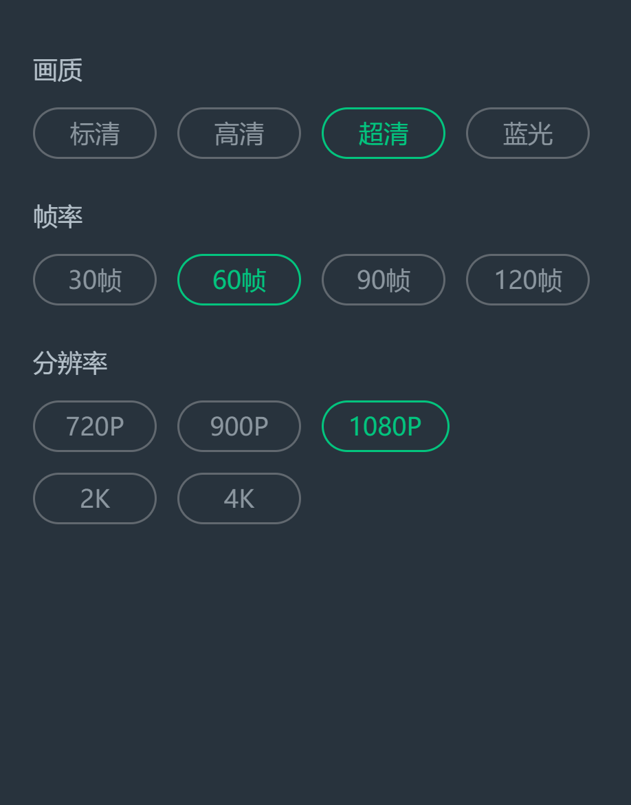

# 网易云游戏 cg.163.com 移动端 Web 接口逆向报告

> 目标站点：`https://cg.163.com/`（移动端 H5 / 触摸版）  
> 逆向方式：静态拆包（3 个 JS bundle）+ Playwright 真机仿真抓包 + 直接 HTTP 复现  
> 接口总数：**272** 条（自动抽取），真实样本 **34** 份，实测用例 **37** 条  
> 生成时间：2026-11-06

## 0. 摘要

| 项目 | 结论 |
|---|---|
| 前端框架 | Vue 2 + Vuex + Vue Router（hash 模式）+ axios |
| 静态资源基址 | `https://ps.res.netease.com/cloudgame/app/` |
| API 网关 | `https://n.cg.163.com/`（备用 `https://nr.cg.163.com/`） |
| 接口前缀 | `api/v1/`（多数匿名可读）、`api/v2/`（需登录 + 请求体加密） |
| 移动端标识 | 请求头 `X-Platform: 1`（web-mobile），iOS H5 为 `4` |
| 鉴权 | `Authorization: Bearer <token>`，仅有 v2 接口校验 |
| 传输加密 | v2 请求体/响应体做「偏移异或 + Base64」自定义加密，偏移量由登录返回的 `encrypt` 推导 |
| 游玩链路 | `POST api/v2/tickets` 取机位 → `wss://<gateway_url>` 首包 `auth` → WebRTC 收流 → WS `input` 发指令 |
| 悬浮球画质 | WS 指令 `game_set_quality`（单机即时切），帧率/分辨率是重连而非热切换 |
| 匿名边界 | 首页 / 游戏列表 / 游戏详情 / FAQ / 社区 / SEO 全部可匿名取；**启动游戏与「我的」必须登录** |

## 1. 站点结构与资源清单

移动端首页 HTML 仅 7.5 KB，全部内容由 JS 渲染。资源清单：


| 文件 | 大小 | 说明 |
|---|---|---|
| `index.html` | 7,492 B | 移动端首页入口 |
| `js/chunk-vendors.99c7b30a.js` | 717,578 B | Vue/axios 等三方依赖 |
| `js/chunk-common.144278fd.js` | 1,430,699 B | **核心包**：路由、Vuex、加密、输入协议、悬浮球、控制面板 |
| `js/index.414fd574.js` | 506,015 B | 首页/我的/社区等页面逻辑 + 排队 WS |
| `js/run.cbc92ca7.js` | 146,099 B | **游玩页**：WS 信令、WebRTC、输入、画质、错误码 |
| `css/index.8618ec0d.css` 等 | — | 样式 |
| `manifestindex.json` | — | `{"display":"standalone","orientation":"portrait-primary"}` |

游玩页独立入口：`https://cg.163.com/run.html?code=<game_code>`（微信内为 `wxrun.html`，
内部还会跳 `run5.html?code=<game_code>&id=<ts>`）。

## 2. 请求基线（复现任意接口的最小条件）


```http
GET /api/v1/home_page_tabs HTTP/1.1
Host: n.cg.163.com
X-Platform: 1                       # 1=web-mobile(安卓/通用)  4=ios-mobile
X-Channel: web
X-Source-Type: web
X-Ver: <devInfo.versioncode>        # 可留空或 0
Referer: https://cg.163.com/
Origin: https://cg.163.com
User-Agent: Mozilla/5.0 (iPhone; CPU iPhone OS 17_0 like Mac OS X) ...
```

v2 接口额外要求：

```http
Authorization: Bearer <token>
Content-Type: application/octet-stream      # 请求体是加密后的 Base64 文本
```


统一响应包：`{"data": …, "errcode": 0, "errmsg": "", "errmsgcn": ""}`；未登录访问 v2 返回 **HTTP 401** + `errcode=1006 / 登录信息失效，请重新登录`。

## 3. 鉴权与加密

### 3.1 token 落地


登录成功后（`POST api/v1/tokens` / `POST api/v2/auth-token` / 二维码轮询 `GET api/v1/tokens?qrcode_id=`）：

```js
t = cookieSet(randomSplit(resp.encrypt))   // 写进 localStorage 的 NCG-eid
s = cookieGet(t)                           // 还原
o = getOffset2(s)                          // 0..255 的偏移量，后续所有加密都用它
localStorage: NCG-token = resp.token
              NCG-eid   = t
              NCG-id    = resp.user_id
              NCG-encrypt = resp.encrypt
// 二维码/第三方登录走 NCG-token-other / NCG-eid-other
```

### 3.2 自定义加解密（v2 请求体、WS 全部帧）

```js
randomSplit = e => e.split(",").map(x => x.split(":")[1]).join("d")   // "a:12,b:34" -> "12d34"
cookieSet   = e => e.split("").map(c => c.charCodeAt() + "-" + rand2()).join("-")
cookieGet   = e => String.fromCharCode(...e.split("-").filter((_, i) => i % 2 === 0))
getOffset2  = e => getOffset(...e.split("d").map(Number).slice(1))
getOffset   = (a, b, c) => (a | b) % 256 + c
offsetEn    = (off, txt) => base64(utf8(txt).map(b => (b + off) % 256))
offsetOut   = (off, b64) => utf8(base64decode(b64).map(b => (b - off + 256) % 256))
```

Python 复刻见 `sdk/cgapi.py`：`offset_from_encrypt()` / `offset_en()` / `offset_out()`。

### 3.3 加密生效范围
- **只对 `api/v2/` 生效**：请求体加密、响应体解密、携带 Bearer。
- v1 接口全部明文，匿名可读 —— 这是无账号逆向的主入口。

### 3.4 X-Platform 取值表


| 值 | 含义 |
|---|---|
| 0 | web-pc |
| **1** | **web-mobile（本次目标）** |
| 2 / 3 | android-mobile-platform / android-mobile-apk |
| **4** | **ios-mobile-platform（H5）** |
| 5 / 6 | android-tv-apk / android-tv-platform |
| 7 / 8 | pc-micro / pc-native-platform |
| 9 | ios-native-platform |
| 10 | ios-micro |
| 12 | android-mobile-pc |
| 13 | mac-native-platform |
| 14 | harmonyos-h5-platform |


## 4. 接口总览

| 分类 | 接口数 |
|---|---|
| 首页/推荐 | 22 |
| 游戏/详情 | 22 |
| 启动/排队 | 13 |
| 悬浮球/键位/画质 | 4 |
| 我的/账户 | 96 |
| 登录/鉴权 | 17 |
| 云电脑/云手机 | 9 |
| 社区/直播 | 52 |
| SEO | 2 |
| 其他 | 35 |
| **合计** | **272** |

| Method | 数量 |
|---|---|
| GET | 173 |
| POST | 78 |
| PATCH | 8 |
| DELETE | 13 |

## 5. 首页（推荐流）

移动端首页首屏按固定顺序打 17 个接口，全部匿名可读：


| 顺序 | 接口 | 作用 |
|---|---|---|
| 1 | `GET api/v1/versions/@current?package_name=H5` | 客户端版本 / 强更 |
| 2 | `GET api/v1/versions/infos?need_latest=1&platforms=0..9` | 全端版本 |
| 3 | `GET api/v1/client-settings/@current` | 免时长、排队提醒、新手免费天数 |
| 4 | `POST api/v1/group-customize-settings` ×4 | 分组灰度配置（realname / QQ_games / gray_style_h5 / multi_cloud_pc_tag） |
| 5 | `GET api/v1/search_keyword_hints` | 搜索联想词 |
| 6 | `GET api/v1/home_page_tabs` | 顶部 tab |
| 7 | `GET api/v1/notices/list` | 公告列表 |
| 8 | `GET api/v1/resource_icons?type=main_page` | 图标资源（匿名返回空） |
| 9 | `GET api/v1/text_res_position_items` | 文字资源位 |
| 10 | `GET api/v1/banners?banner_type=mobile_home` | 轮播 |
| 11 | `GET api/v1/pendant_list?pendant_type=mobile_home` | 悬浮挂件 |
| 12 | `GET api/v1/popups` | 弹窗 |
| 13 | `GET api/v1/main_recommendations?main_recommendation_type=mobile_home` | 推荐流（主体） |
| 14 | 同上 + `&tab_id=<id>` | 切 tab 后重新拉 |
| 15 | `GET api/v1/speed_url?game_type=mobile` | 测速 + 默认画质码率 |
| 16 | `GET api/v1/speed_url?game_type=pc` | 同上（端游） |
| 17 | `GET api/v1/hot-searches` | 热搜 |


### 5.1 home_page_tabs

实测 tab 列表（`tab_type` → `tab_id`）：

| rank | tab_type | title | tab_id |
|---|---|---|---|
| 1.0 | `recommend` | 推荐 | `66051b810d5fa1f0204c294f` |
| 2 | `mobile` | 手机游戏 | `66051b810d5fa1f0204c2950` |
| 3 | `pc` | PC游戏 | `66051b810d5fa1f0204c2951` |
| 3 | `tag_game_list` | 限免专区 | `689dba31e52a16c8c74352b1` |
| 5 | `more_game` | 云电脑/云手机 | `66051b830d5fa1f0204c2953` |
| 6 | `qq_game` | 免时长 | `66051b810d5fa1f0204c2952` |

单条 tab 字段：`create_time, exclude_channels[], people_list_ids[], platforms[14], rank, tab_id, tab_type, title, update_time, valid`。


### 5.2 main_recommendations（推荐流）

返回**模块数组**（实测 8 个模块），每模块结构一致：

```json
{
  "create_time": 1762…,
  "creative_workshops": [],
  "delay": 0,
  "excluded_recommendation_tags": [],
  "game_behavior_tags": [],
  "include_channels": [],
  "main_recommendation_id": "…",
  "games": [
    {
      "card_type": "game",
      "btn_text": "秒玩",
      "display_game": {
        "game_code": "wow_cn_high",
        "carousels": [{"carousel_type": 3, "screenshot": "…", "width": 1280, "height": 720},
                      {"carousel_type": 2, "video_url": "…"}],
        "daily_free_time": 0,
        "description": ["…"],
        "developer": "…",
        "free": false,
        "game_detail_tags": []
      }
    }
  ]
}
```

实测模块数与首三个 game_code：

| 模块 | 卡片数 | 前 3 个 game_code |
|---|---|---|
| 0 | 5 | wow_cn_high, yzr0, yzr0_high_mg |
| 1 | 4 | lsxyly, dhwxd, xbgd |
| 2 | 5 | wxnnsy, lysk, dhpp |
| 3 | 5 | bhxqtd, jql, bh3 |
| 4 | 5 | mcsy, dzpd, dwrg |
| 5 | 5 | hysxzy_mumu, wbqj_mumu, yslzm |
| 6 | 5 | mc, eve, nshpc |
| 7 | 5 | wdsjzxb, clx, mrzh |

### 5.3 banners / popups / pendants


- `banners`：`{banners:[{banner_id, banner_type, banner_action_type, game_code, game_name, game_type, image, link, open_type, open_content, popup_content, platforms[], people_list_id[], tab_ids[], scene_value, rank, valid, valid_begin_time, valid_end_time}], total}`。`link` 可能为 `cloudgaming://showactivity?url=…`。
- `popups`：`{popups:[…], total}`
- `pendant_list`：`{pendants:[…]}`；`api/v1/pendants?pendant_type=live_room_homepage|topic` 匿名返回 `{}`。
- `notices/@current`：`{content, notice_id, version, valid_begin_time, valid_end_time}`

### 5.4 speed_url（同时决定默认画质）
```json
{"bluray":10,"bluray_1080p":16,"default_quality":"high","default_quality_1080p":"high",
 "high":7,"high_1080p":12,"low":0,"low_1080p":2,"middle":3,"middle_1080p":7,
 "no_speed_test":true,"speed_test_expire":43200,"speed_url":"https://g.fp.ps.netease.com/…"}
```
键为画质档位，值为该档位建议码率；`default_quality` 是首进游戏的默认档位。


## 6. 游戏选择与详情


| 接口 | 说明 |
|---|---|
| `GET api/v1/games?page=&per_page=&game_type=mobile|pc&src=4` | 分页游戏列表，返回 `{games[], total, cloud_pc?, cloud_mobile?, ext_games?}`。**不带参数会一次返回 1,826 条 / 6 MB** |
| `GET api/v1/games/<game_code>` | 游戏详情（142 字段），匿名可读 |
| `GET api/v2/games/<game_code>` | 同上 v2 版，需登录（会带用户个性化字段） |
| `GET api/v1/games/<game_code>/...` | 见附录 |

游戏库规模（`api/v1/games` 全量 1,826 条实测统计）：

| 维度 | 分布 |
|---|---|
| `game_type` | mobile 996 / pc 829 / cloud-mobile 1 |
| `screen` | horizontal 1,616 / vertical 210 |
| `free` | true 557 条 |

### 6.1 游戏详情关键字段

以 `wow_cn_high`（魔兽世界-高配）为例：

```json
{
  "game_code": "wow_cn_high", "name": "魔兽世界（无限/正式服/怀旧服/时光服）-高配",
  "game_type": "pc", "screen": "horizontal",
  "fps_default": "30", "fps_supports": ["30", "60"],
  "resolution_default": "900p",
  "resolution_supports": ["auto", "720p", "900p", "1080p"],
  "enable_resolution_config": true,
  "coins_consume_per_minute": 4, "ori_coins_consume_per_minute": 9,
  "free": false, "daily_free_time": 0,
  "entry_platforms": ["web-mobile", "ios-mobile-platform",
                      "android-mobile-platform", "ios-native-platform"],
  "enable_send_clipboard": true, "can_hang_up": false, "cloud_mobile": false,
  "params": {"startgame_slogan": "每小时低至1.7元"},
  "resolution_configs": [
    {"platform": "android-mobile-platform", "index": 0,
     "fps_default": "30", "fps_supports": ["30","60","90","120"],
     "resolution_default": "1080p",
     "resolution_supports": ["auto","720p","900p","1080p","2k","4k"]},
    {"platform": "ios-native-platform", …},
    {"platform": "web-pc", …},
    {"platform": "pc-native-platform", …},
    {"platform": "ios-mobile-platform", …}
  ]
}
```

`resolution_configs` 按 `platform` 区分，前端用 `getXPlatformStr()` 匹配当前端 —— 移动端 Web
（`web-mobile`）通常没有独立条目，会回落到通用值，所以移动端 UI 往往只暴露「画质」而不暴露
「帧率/分辨率」。


## 7. 启动与排队


### 7.1 申请机位 `POST api/v2/tickets`（真机实测成功）

前置：先 `POST api/v2/network-tests` 上报测速，再带具体 region 申请。

```python
api.stop_game('mrfzzmd')          # 有机位未退会 400/1811
time.sleep(4)
api.post('api/v2/network-tests', {
    'latency': 600, 'bandwidth': 60, 'quality': 'high',
    'ua': UA, 'details': [{'region': 'ghnfs', 'latency': 600}]})

tk = api.post('api/v2/tickets', {
    'regions': ['ghnfs'],          # 必须是具体 region code，空数组报 404/1288
    'game_code': 'mrfzzmd',
    'codecs': ['h264'],
    'width': 1170, 'height': 2532,
    'extra': {'dpi': 3, 'resolution': '1170x2532', 'source_type': 'web',
              'network_test_info_list': [{'region': 'ghnfs', 'latency': 600, 'bandwidth': 60}]},
    'apk_decoder': {'model': '', 'decoder': []}})
```

**实测响应（`明日方舟：终末地（官服）`，2026-11-06，已脱敏）：**

```json
{"_id": "…", "game_code": "mrfzzmd", "game_name": "明日方舟：终末地（官服）",
 "game_type": "mobile", "platform": "web-mobile", "screen": "horizontal",
 "gateway_url": "wss://gw-lt-hnfs-01.cg.163.com:6443/ws",
 "region": "ghnfs", "region_name": "华南三区",
 "lock_detail": {"agent_ip": "10.0.0.1", "container_idx": 24, "ip": "10.0.0.1",
   "port": "6124", "external_ip": "198.51.100.8", "region": "ghnfs",
   "width": 1280, "height": 720, "game_audio_port": 6724, "game_video_port": 6824,
   "debug": {"container": "topa10_261106_000000,t-24", "encoder": "high,None",
             "host": "ahnfs10000"}},
 "additional_data": {"client_ip": "203.0.113.45", "dpi": 3, "platform": 1,
   "resolution": "1170x2532", "is_cpa": 1, "user_position_type": 1},
 "expires": 1700000001, "ticket": "4641a934-…", "time_left": 24,
 "fast_created": true, "preboot": false, "non_vip_queue_len": 0, "non_vip_queue_time": 1,
 "game_platforms": [0,1,2,3,4,8,9,14,6]}
```

`regions` 全集（`GET api/v2/media-servers?game_code=` 返回的 11 个）：
`ghbtj`（华北天津）、`ghdjn`、`ghdnb`、`ghnfs`（华南三区）、`ghzcs`、`gxbxa`、`gxncq`、
`zmdhdcz`、`zmdhdnb`、`zmdhnfs`、`zmdxbxa`。

**响应有两种形态：**

1. **直接给机位**：带 `expires` + `gateway_url`（上面实测即是）
2. **进排队**：无 `expires` → 走 `wss://n.cg.163.com/push/ws`

### 7.1.1 验收：从 tickets 到出画面（全链路已跑通）

```
POST api/v2/tickets          → gateway_url = wss://gw-lt-hnfs-01.cg.163.com:6443/ws
  ↓ 连 WS（明文 auth，不加密！）
{"op":"auth","data":{"user_id":"67d9…","token":"…","game_code":"mrfzzmd",
 "w":1170,"h":2532,"quality":"high","codecs":["h264"],"platform":1}}
  ↓ 服务端先推 SDP
{"op":"offer","data":{"sdp":"v=0…"}}
  ↓ 再推
{"op":"result","data":{"container":"topa10_261106_000000,t-25","encoder":"high,None","host":"ahnfs10000"}}
  ↓ 陆续推 input 事件
{"op":"input","data":{"cmd":"8 0"}}                              // 横屏
{"op":"input","data":{"cmd":"2"}}                                // 隐藏键盘
{"op":"input","data":{"cmd":"23 com.android.litelauncher/…"}}    // 前台应用
{"op":"input","data":{"cmd":"18 0"}}                             // 摄像头状态
```

Playwright 复现时 `video` 元素实测 `videoWidth=1280 / videoHeight=720 / readyState=4 /
paused=false / currentTime 递增`，`srcObject.getTracks()` = `["audio:live","video:live"]`
→ **WebRTC 真流出画面**。

> ⚠️ 复现要点：`run.html` 会校验 localStorage，且站点 storage 封装给每个值套
> `{"data": <值>}` 信封。必须用 `localStorage.setItem(k, JSON.stringify({data:v}))` 写
> `NCG-token / NCG-eid / NCG-id / NCG-gwurl / NCG-gameType / NCG-region / NCG-lockdetail`
> 等键，且在 `https://cg.163.com` 源下写（先 `goto` 再 `evaluate`）。
> 直接写裸值会被读成 `null` → 弹回首页。

### 7.2 tickets 错误码分支

| HTTP / errcode | 含义 | 前端行为 |
|---|---|---|
| `33803` | 多实例冲突 | 找有 `queue_status` 的 `proxy_user_id`，切到该实例 |
| `400 / 1811` | 媒体服需刷新 | 重新 `getMediaServes()` 再试 |
| `404 / 1209` | 需选区域 | 弹「测速最佳选区 [X] / 排队最少选区 [Y]」，两按钮各自 `startQueue()` |
| `404 / 1250` | 网络太差 | `media.showBadNetwork` |
| `404 / 1269` | 需选区域（带 `fastest_region_name` / `fastest_queue_out_region_name`） | 同上，埋点 `select_region_arm` / `select_region_hmy` |
| `400 / 1279` | 云电脑 C 盘损坏 | 提示前往「我的-设置-重置云电脑C盘」 |
| `403 / 1251` | 长提示（6s） | toast |

### 7.3 排队推送 `wss://n.cg.163.com/push/ws`

- 连接参数：`reconnection: true, reconnectionAttempts: 9`
- 客户端 **只发 4 个 op**：`auth` / `enqueue` / `dequeue` / `destroy_ticket`
- `auth` 数据：`{user_id, token, platform: 1, apk, ua}`
- 服务端推送 op 全集（33 个）：
```
games_playing_status                 games_playing_status_multi_proxy
queue_status                         queue_status_multi_proxy
queue_canceled                       queue_canceled_multi_proxy
queue_success                        queue_success_multi_proxy
queue_success_soon                   queue_success_soon_multi_proxy
queue_switch_status                  queue_switch_status_multi_proxy
ticket_destroyed                     ticket_destroyed_multi_proxy
error                                error_multi_proxy
order_paid                           message
read_msgs                            cloud_mobile_error
queue_speed                          has_new_followers
clear_new_followers                  growth_value_changed
level_changed                        friend_open_live_room_v2
cancellation_by_other_endpoint       coupon
unlock_cloud_pc_high                 promotion_coupon_received
promotion_coupon_used                queue_popup
create_signed_agreement_success
```
- 状态机：`queue`（「当前最佳选区：X，当前排第 N 位」）→ `queuesuccess`（「N 秒后自动放弃」）
  → `queuefail`（「由于排队成功后未及时确认进入游戏，本次排队无效」）
- 排队人数上限展示：普通 `500+`、PC VIP `300+`（`YS_QUEUE_NUM` / `YS_QUEUE_VIP_NUM`）
- 兜底轮询：`GET api/v2/users/@me/status` 每 10s（页面隐藏时暂停）


## 8. 游玩态：信令、画面与输入


### 8.1 入口守卫

`run.html?code=<game_code>` 启动时：

```js
Zn = getQuerys("code")
io = storage.get("NCG-token")            // 或 NCG-token-other
no = storage.get("NCG-eid")              // 或 NCG-eid-other
oo = no && getOffset2(cookieGet(no))     // 从本地反推 OFFSET
// 取 gateway_url：store.user.game_playing.gateway_url || storage.NCG-gwurl
// 无 gateway_url → toast("网关地址不存在") → 跳回首页
```

→ **直接访问 `run.html` 而不带 token/gwurl，会被弹回首页。** 这是匿名测不到游玩态的根本原因。

### 8.2 网关 WebSocket `wss://<gateway_url>`

首包必须 `auth`：

```json
{"user_id": 123456, "token": "<token>", "game_code": "wow_cn_high",
 "w": 1280, "h": 720, "quality": "high",
 "codecs": ["h264"], "platform": 1,
 "encoder": "", "fps": "60", "res": "1080p",
 "apk_decoder": {"model": "iOS 17.0", "decoder": []}}
```

- 客户端发出的 op 只有 **4 个**：`auth` / `answer` / `input` / `game_set_quality`
- 服务端回包 op：`result`（auth 成功） / `offer`（SDP） / `answer` / `error` /
  `game_stop`（`data.code`） / `info`（`data.game_info`） / `input`（事件推送） / `close`

**加密规则（重要，踩过坑）**

```js
socketSend(e, t, i, n) {
  const c = {id: …, op: e, data: t || {}};
  this.$ws.send(n || s ? c : offsetEn(this.OFFSET, JSON.stringify(c)));
  //               ↑ plain=true                  ↑ 正常路径
}
```

| op | 是否加密 | 依据 |
|---|---|---|
| `auth` | **明文** | `onOpen` 里 `socketSend("auth", i, cb, !0)`，第 4 参为 `true` |
| `input` / `answer` / `game_set_quality` | **offsetEn 加密** | 正常路径 |

一开始按「全加密」发 `auth`，网关回 `{"errcode":400,"errmsg":"format invalid"}` ——
就是这个原因。改发明文后立刻收到 `offer` + `result`。

- 心跳：`{"op":"input","data":{"cmd":"0 <timestamp>"}}`

### 8.3 WebRTC 协商

```
服务端 → offer(SDP)  →  客户端 setRemoteDescription(offer)
    → createAnswer() → SDP 后处理 → setLocalDescription → 等 iceGatheringState==="complete"
    → 回 {"op":"answer","data":{"sdp":…,"type":"answer"}}
```

`iceTransportPolicy: "relay"`，ICE 服务器来自 `POST api/v2/turn-credentials`（`{region}` → `{uris, username, credential}`）。

SDP 后处理 4 步（移动端小带宽优化）：

| 步骤 | 处理 |
|---|---|
| `ee` | 含 `level-asymmetry-allowed` 的 fmtp 追加 `x-google-start-bitrate=1000;x-google-max-bitrate=2800;x-google-min-bitrate=1000` |
| `te` | 每条 `a=rtcp-fb:N nack pli` 后插同号 `a=rtcp-fb:N rrtr` |
| `ie` | opus fmtp 追加 `stereo=1` |
| `Z` | 无 candidate 的 m 段补一条 host candidate |
| 最后 | 正则剔除 `a=rtpmap:100 H265/90000`（禁 H265） |

画面统计（悬浮球网络状态数据来源）：解析 `candidate-pair`（`currentRoundTripTime` → 延时）
与 `inbound-rtp` 的 `bytesReceived / packetsLost / jitterBufferDelay / nackCount`。

### 8.3.1 SDK 端到端验证（纯 Python，无浏览器）

`work/play_sdk.py` 用 `sdk/cgapi.py` 的 `PlaySession` 独立跑完整条链路，
**不依赖浏览器**，实测输出（2026-11-06）：

```
uid=5f2c1a7d8b3e4f60a1c2d3e4 offset=85
[-] 已释放旧机位
[+] network-tests ok
[+] 机位 华南三区 gw=wss://gw-lt-hnfs-01.cg.163.com:6443/ws ttl=24s
    container=topa10_261106_000000,t-34
[+] auth ok in 0.61s -> {'container': 'topa10_261106_000000,t-34',
                         'encoder': 'high,None', 'host': 'ahnfs10000'}
[+] 收到 SDP offer 2593 字节: 'v=0

o=- 1700000006 1 IN IP4 198.51.100.7...'
[+] set_quality low     -> result None
[+] set_quality middle  -> result None
[+] set_quality high    -> result None
[+] 已发 tap(0.5, 0.5)
[-] 收服务端 input 事件 3s:
     {'cmd': '9 27643,1,4f8e,eyJtIjoiZGF0YUNoYW5uZWxSZWFkeSIsInBrZyI6...'}
[+] closed
[-] 已释放机位
```

`9 <port>,1,<hex>,<base64>` 解开正是 `{"m":"dataChannelReady",
"pkg":"com.hypergryph.endfield","t":1700000003}` —— 服务端在等客户端建 DataChannel
（`common_setting.enable_data_channel=false` 时不会建，输入仍走 WS）。

结论：**`auth` 明文 + `offer/answer` + `op:input` 三件事在纯 Python 里都能复现**，
没浏览器也能驱动云游戏。

### 8.4 输入协议 `{"op":"input","data":{"cmd":"<code> <args…>"}}`

坐标统一换算：`Math.ceil(65535 * x / videoWidth)`（`POS_TYPE_ABSOLUTE=1`）。

**移动端触摸（本次目标）**

| cmd | 含义 |
|---|---|
| `1 <x> <y> <id>` | 按下（多指，`id` 0..19） |
| `2 <x> <y> <id>` | 移动 |
| `3 <x> <y> <id>` | 抬起 |
| `4` | 取消全部触点 |
| `5 <text>` | 文本输入（软键盘上屏） |
| `6 <keycode>` | 单键（返回键等） |
| `8 <x> <y> <id>` | 点击 tap |
| `0 <ts>` | 心跳 |
| `10 <platform>` | 启动后首条，上报平台 |
| `13 <lon> <lat>` | GPS |
| `14 <0..1>` | 视图变换进度 |
| `15 <json>` | 业务透传 |
| `17 <sec>` | 休眠 |
| `18 <url>` | 摄像头 |
| `25 tochscreen|keymouse` | 输入模式切换 |
| `26 <gamma> <beta> <alpha> 0 <ts*1e6>` | 摇一摇（陀螺仪） |
| `28` | 触发摇一摇 |
| `29 <text>` | 贴文本到云端 |
| `130 <data>` | 剪贴板 |

**PC 鼠标/键盘（同一 WS 协议，端游/云电脑用）**

| cmd | 含义 |
|---|---|
| `100/101 <btn> <posType> <x> <y> <state>` | 鼠标按下 / 抬起 |
| `102 <posType> <x> <y> <state>` | 鼠标移动 |
| `103 <posType> <x> <y> <delta> <state>` | 滚轮 |
| `104/105 <keyCode> <keyName> <state>` | 键盘按下 / 抬起 |
| `120/121 <keyCode> <keyName>` | 单键 |
| `110/111 <idx>` | 手柄连接 / 断开 |
| `112/113/114 <idx> …` | 手柄按钮 / 摇杆 / 释放 |

### 8.5 服务端下发事件（`op:"input"` 且 cmd 为事件码）

| 码 | 行为 |
|---|---|
| `0` | 心跳回显（算延时） |
| `1` / `2` | 显示 / 隐藏软键盘 |
| `3` | 微信扫码登录指引 |
| `7` | 移动端 launcher |
| `8 <1|3>` | 竖屏 / 横屏切换 |
| `12 <url>` | 打开外链 |
| `17 <x>` / `108` | 截图 / PC 截图 |
| `18` / `100` | 设置鼠标指针样式 |
| `101` | 锁定鼠标指针 |
| `102` | PC 键盘模式 |
| `103` | 修改帧率 |
| `104` | 远端模式 |
| `105` | 手柄振动 |
| `110 <cmd>` / `21 <cmd>` | 写剪贴板 |
| `116 <text>` | toast |
| `22` | 容量不足提示 |
| `9 <n>,1,<hex>,<base64>` | DataChannel 就绪握手（base64 解出 `{"m":"dataChannelReady","pkg":"…"}`），每秒重推 |
| `18 0` | 摄像头状态 |
| `23 <pkg>/<activity>` | 当前前台应用（如 `com.hypergryph.endfield/com.u8.sdk.U8UnityContext`） |

### 8.6 断线与错误码

| code | 处理 |
|---|---|
| 0 | 正常退出 |
| 1001 / 1008 / 1003 / 1005 / 1004 / 1709 | 重连 |
| 1512 | 媒体服 SDP 连续失败 → 转 1501 |
| 1236（或 pc 的 509） | 云游戏重启中 |
| 403 / 1213 | 切媒体服（读 `NCG-mediaservers` 选延时最低） |
| 2004 | 设备不支持游玩 |
| 超时 | 「由于您太久没回来游戏已关闭」 |


## 9. 悬浮球与画质（真机实测）


> 以下内容全部来自 2026-11-06 的真实运行：真实账号 + `POST api/v2/tickets` 真机位 +
> `run.html` 全流程，截图见 `docs/img/`。

### 9.1 悬浮球（flyme）行为

```html
<div class="flyme" :class="[{on, move:!on}, orientation]">
  <div class="flyme-in"></div><div class="flyme-out"></div>
</div>
```

- 拖动松手吸附左右边缘：`orientation = x > width/2 ? "right" : "left"`
- 垂直方向钳制在屏幕高度 **15% ~ 75%**
- 位置持久化：`POST api/v2/users/@me/games/<code>/common_setting`，body `{ball_x: 0|100, ball_y: 0..100}`
- 隐藏状态存本地 `NCG-flyme-hide`（多账号 `-<uid>`）
- 点击 → `showcontrolpanel()`，同时解绑输入事件（暂停向云端发触摸）

### 9.2 移动端悬浮球菜单（真机抓到的实际 DOM）

实测打开后是 `section.mobilemenu.mobilemenu-has-options`，左栏为一级菜单、
右栏为开关与画质。**菜单顶部显示当前选区（如「华南三区」），不是静态包里的
「服务器:xx | 延时:xx | 丢包:xx」——那行只是 PC 面板的样式。**

```
section.mobilemenu
├─ p.mobilemenu-stats          华南三区
├─ ul.mobilemenu-list          一级菜单（横向图标条）
│   ├─ 常用操作        icon_options     （展开右栏开关组）
│   ├─ 官方充值        （动态图标 URL，来自 api/v2/resource_icons 或 game detail）
│   ├─ 云玩抽奖        （动态图标 URL）
│   ├─ 福利中心        icon_gamewelfare  + 角标「1个活动待参与」
│   ├─ 退出游戏        icon_exit
│   └─ li.mobilemenu-itemother
│        ├─ .controlpanel-time  icon-timer +「免费时长 21分钟」
│        └─ p.mobilemenu-user   ID:138****0000
└─ div.mobilemenu-panel        右栏（常用操作展开后）
    ├─ 显示网络状态          <div class="switch on">
    ├─ 后台挂机（红点）      <div class="switch">
    ├─ 麦克风                <div class="switch">
    ├─ 操作时隐藏悬浮球      <div class="switch">
    ├─ 画质  .mobilemenu-panel-line2
    │    <li name="low">标清</li> <li name="middle">高清</li>
    │    <li name="high" class="on">超清</li> <li name="bluray">蓝光</li>
    └─ 工具
         ├─ 小窗模式   icon_menu_pip
         └─ 分享给朋友 icon-share（红点）
```

关键结论：

| 项 | 实测值 |
|---|---|
| 画质默认选中 | `high`（超清）—— 与 `GET api/v1/speed_url?game_type=mobile` 的 `default_quality: "high"` 一致 |
| 画质档位 name 属性 | `low` / `middle` / `high` / `bluray` |
| 一级菜单是否横向滚动 | 是（`.mobilemenu-list` 横向，`id="Jmenu<随机5位>"`） |
| 「常用操作」默认展开 | 是（`li.mobilemenu-item.in`） |
| 退出游戏是否带确认 | 是（`external` 走 `exitGame` 流程，非 inApp 走 `closeWindow`） |

菜单截图：`docs/img/menu-mobile.png`

### 9.3 画质切换：真机 WS 帧（已抓到明文）

点击「标清 / 高清 / 超清」时，客户端发出（`offsetEn` 编码后作为 WS 文本帧）：

```json
{"id":"1793948576xxx","op":"game_set_quality","data":{"quality":"low"}}
{"id":...,"op":"game_set_quality","data":{"quality":"middle"}}
{"id":...,"op":"game_set_quality","data":{"quality":"high"}}
```

服务端回：

```json
{"id":"...","op":"result","data":{}}
```

失败回 `{"op":"error","data":{...}}` → toast「画质切换失败」。

**点击「蓝光」不发 WS 帧**：因为该账号 `user.bluray = false`，前端在
`setGameQuality` 之前就拦截，弹「提示 / 成为会员即可享受蓝光极致画质。」，
按钮「暂不」「开通会员」（截图 `docs/img/quality-bluray-dialog.png`）。
端游（pc）文案不同，按云币/小时计价。

**帧率 / 分辨率不是热切换**：`setFps` / `setResolution` 走
`resetGateWaty()` 重连整个 WS（改 `fps` / `res` 后重新 auth）。
移动端 H5 的 `resolution_configs` 里只有 `web-pc / ios-mobile-platform /
android-mobile-platform / ios-native-platform / pc-native-platform`，
所以移动 H5 只暴露「画质」一栏，没有帧率/分辨率选项。

### 9.4 通用设置持久化 `POST api/v2/users/@me/games/<code>/common_setting`

| 字段 | 含义 | 实测来源 |
|---|---|---|
| `ball_x` | 悬浮球水平位置，0=左吸附 / 100=右吸附 | 拖拽结束 `onTransitionend` |
| `ball_y` | 悬浮球垂直位置，0..100 | 同上 |
| `show_network` | 是否显示网络状态条 | 「显示网络状态」开关 |
| `key_transparency` | 键位透明度 0..100 | 键位编辑面板 |
| `menu_arouse_key` | 菜单唤起键（默认 `escape`） | 「修改菜单键」 |
| `enable_two_finger_scrolling` | 双指滚动 | 「常用操作」 |
| `key_mode` / `mouse_mode` | 键位模式 / 鼠标模式 | PC 面板 |

`GET api/v2/users/@me/games/<code>/common_setting` 实测返回（节选）：

```json
{"ball_x": 0, "ball_y": 75, "background_expires": 15,
 "enable_data_channel": false, "enable_data_channel_v2": true,
 "enable_two_finger_scrolling": true, "disable_move_mouse_click": false,
 "data_channel_params": {"connect_timeout_ms": 5000, "disable_keepalive": 1,
   "keepalive_interval_ms": 1000, "keepalive_interval_ms_after_no_resp": 500,
   "switch_ws_after_x_failure": 12},
 "free_time_left_tips_info": [
   {"opportunity": 1, "free_time_left_tips": "您今日剩余免费时长不足1分钟，【菜单】开通会员无限畅玩！"},
   {"opportunity": 1000, "is_real_time": true,
    "free_time_left_tips": "您今日剩余免费时长：##时间##分钟，【菜单】开通会员无限畅玩！"}],
 "game": { ...完整 game detail... }}
```


### 9.5 分辨率与帧率：屏幕适配分四层，不是一个接口



> 端游在手机浏览器里的「画质帧率」面板（真机截图）：画质 4 档 / 帧率 4 档 / 分辨率 5 档，绿框为当前选中。


「适配不同设备屏幕」在这套系统里不是一个可调的 REST 接口，而是**四层叠起来的**。
按从前到后排列：

#### 第 0 层（自动）：客户端把屏幕换算成画布尺寸

`getVideoScreen(w, h, isPort, gameType, greyWM)`（`chunk-common.144278fd.js:1201447`）。
它在 `run.html` 启动时算一次、切分辨率时（`resetScreenSize()`，`chunk-common.144278fd.js:542122`）再算一次：

```js
getVideoScreen=function(e,t,i,n,s){var o=window.devicePixelRatio||1,a=t||720,r=e||1280;
 if(v.isMobile()){
   var d=h.os.ios&&!(weixin/qq/aweme/news), f=navigator.standalone,
       g=d&&v.isIphoneX(), _=g?v.getIphoneXSaftArea():0;
   d&&!i||f ? (l=window.screen,c=Math.ceil(l.width),u=Math.ceil(l.height))
            : (c=Math.ceil(innerWidth||screen.width),u=Math.ceil(innerHeight||screen.height));
   i ? (p=Math.max(c,u)-(f?g?_:20:0), m=Math.min(c,u))
     : (p=Math.max(c,u)-(g?_:0),     m=Math.min(c,u)-(f?20:0));
   "pc"==n ? (r=Math.round(p*devicePixelRatio), a=Math.round(m*devicePixelRatio))
           : s ? (r=p,a=m) : r=Math.floor(p*a/m);
 } else if("pc"==n){ var y=window.screen; r=Math.round(y.width*o); a=Math.round(y.height*o);}
 return {w:r,h:a}}
```

| 场景 | 宽度 | 高度 | 说明 |
|---|---|---|---|
| 手游（`game_type=mobile`） | `floor(长边 × 720 / 短边)` | 固定 `720` | **按设备宽高比反算宽度**，所以任何屏幕都自适应，无需接口 |
| 端游（`game_type=pc`） | `max(屏幕css) × dpr` | `min(屏幕css) × dpr` | 直接吃满设备像素 |
| iPhone X 系列 | 长边再减安全区 | — | 屏幕像素 `1170×2532 / 1284×2778 / 1080×2340` → 扣 `44`；`1179×2556 / 1290×2796` → 扣 `54` |
| PWA standalone | — | 再减 `20` | `navigator.standalone` 为真时 |

实测对照（iPhone 14，390×844、dpr 3）：

| 设备/场景 | 公式结果 | run 页 auth 里真实发的值 |
|---|---|---|
| 端游 `wow_cn_high` | `2400 × 1170` | `{"w":2400,"h":1170}` ✅ |
| 手游 `mrfzzmd` | `1558 × 720` | 机位 `lock_detail` 给的是 `1280×720`（见第 3 层） |

SDK 已复刻成静态方法：

```python
from cgapi import CGAPI
CGAPI.video_screen(screen_w=390, screen_h=844, dpr=3, game_type="pc")
# {'w': 2400, 'h': 1170}
CGAPI.video_screen(screen_w=390, screen_h=844, game_type="mobile")
# {'w': 1558, 'h': 720}
CGAPI.iphone_x_safe_area(390, 844, 3)     # 1170×2532 → 44
```

#### 第 1 层（运营配置）：`customize-settings`，**匿名可读**

`GET api/v1/customize-settings/{group}/{key}` —— 分辨率相关的四条全在 `pc_game` 组下。
`v1` 匿名可访问，`v2` 需要登录（内容相同）。

| key | 实测值 | 作用 |
|---|---|---|
| `platform_resolution` | `android-mobile-platform##720p,900p,1080p##30,60##900p##30;ios-native-platform##720p,900p,1080p##30,60##900p##60;android-mobile-pc##720p,900p,1080p##30,60##900p##30;web-pc##900p,1080p,2k##60##1080p##60;` | 各平台默认档位。格式 `<platform>##<分辨率列表>##<帧率列表>##<默认分辨率>##<默认帧率>`，多条 `;` 分隔 |
| `resolution_auto_2k_enable` | `1` | 是否放行「跟随本机」 |
| `resolution_auto_2k_whitelist` | `phy_cloud_pc_high_x,yysls_4070ti,blackmyth_4070Ti,wxnn_4070,qrsjpc_4070ti,blackmyth_wegame_4070,yjwj_ntes_4070Ti,zxsjpc_4070,monsterhunterwilds_4070ti,cloud_pc_high,wegame_4070ti` | 白名单内游戏也放行「跟随本机」 |
| `resolution_tips` | `提高分辨率/码率，依赖网速及设备解码性能，如遇卡顿请降低画面配置。<br/> 强烈建议先退出游戏返回桌面，再从菜单栏切换新的分辨率配置…` | 升档前的确认文案 |

`allowAutoGameResolution = (resolution_auto_2k_enable === 1) || whitelist.includes(game_code)`，
它决定 `QualitySelector` 里要不要出现「跟随本机（W*H）」这一项
（`resolutions = (resolutionSupports||[]).filter(t => allowAutoGameResolution || t !== "auto")`）。

#### 第 2 层（逐游戏能力）：游戏详情里的 `resolution_configs`

`GET api/v1/games/<code>` 返回，**只有 `enable_resolution_config === true` 的游戏才有**，
而且只有 `game_type === "pc"` 的游戏会走分辨率逻辑（`run.cbc92ca7.js:133277`）。

`wow_cn_high` 实测 5 条：

| platform | fps_default | fps_supports | res_default | res_supports |
|---|---|---|---|---|
| `android-mobile-platform` | 30 | 30/60/90/120 | `1080p` | auto,720p,900p,1080p,2k,4k |
| `ios-native-platform` | 60 | 30/60/90/120 | `1080p` | auto,720p,900p,1080p,2k,4k |
| `web-pc` | 60 | 30/60/90/120 | `auto` | 720p,900p,1080p,2k,auto,4k |
| `pc-native-platform` | 60 | 30/60/90/120 | `auto` | auto,720p,…,4k |
| `ios-mobile-platform` | 60 | 30/60/90/120 | `1080p` | 720p,…,4k（无 auto） |

顶层还有回落值：`fps_default="30" fps_supports=["30","60"] resolution_default="900p" resolution_supports=["auto","720p","900p","1080p"]`。

手游 `mrfzzmd`：`enable_resolution_config=false`、**没有 `resolution_configs`**，只有顶层同名字段
→ 手游玩家**看不到分辨率调节入口**，画质只有码率四档。

SDK：

```python
api.platform_resolution()                       # 解析成 {platform: {resolutions, fps, default_*}}
api.resolution_options("wow_cn_high", 4)        # 按平台算最终可选项（4=ios-mobile-platform）
# {'enable_resolution_config': True, 'fps_supports': ['30','60','90','120'],
#  'visible_resolutions': ['720p','900p','1080p','2k','4k'],
#  'resolution_default': '1080p', 'fps_default': '60',
#  'allow_auto_game_resolution': True, ...}
```

#### 第 3 层（真正生效）：改 `res`/`fps` 要**重连网关**，重发 auth

分辨率/帧率**不是**走 `game_set_quality`（那只是码率）。真实链路：

```
用户点「1080P」
  → QualitySelector.setResolution('1080p')            chunk-common.144278fd.js:541868
      resetScreenSize()                                重算画布 w/h
      postBehaviors({action:"cg_res_changed",res:t})    埋点
      commit("commonsetting/setGameResolution", t)      Vuex
      setConfig("resolution_default", t)                写 localStorage NCG-game-config
      $emit("resetGateWaty")                             ★
  → resetGateWaty()                                    run.cbc92ca7.js:75447
      GET api/v2/users/@me/status?region=&game_type=    拿最新 gateway_url
      $ws.$reconnect(2, url)                            断开重连
  → onOpen → socketSend("auth", {...res, fps...})       新参数生效
```

`auth` 里带 `if(this.gameFps) i.fps = this.gameFps; if(this.gameResolution) i.res = this.gameResolution;`
（`run.cbc92ca7.js:73153`）。`resetFps` 同构，只是埋点换成 `cg_fps_changed`、存储键换 `fps_default`；
**升帧**（`fps_supports` 里更靠后的一档）会先拉 `resolution_tips` 弹确认。

实测（`work/captures/play10-2026-11-06T10-22-23-184Z/`，直调 `QualitySelector.__vue__`）：

| 动作 | 是否发出新 auth | auth 里的 `res`/`fps` | 面板选中态 |
|---|---|---|---|
| 初始 | — | `res=1080p fps=60` | 分辨率 1080P / 帧率 60帧 |
| `setResolution("720p")` | ✅ 重连 | `res=720p fps=60` | 分辨率 720P |
| `setResolution("2k")` | ❌ 无新帧 | — | 仍 1080P（超出机位能力，被拒） |
| `setFps("30")` | ✅ 重连 | `res=720p fps=30` | 帧率 30帧 |
| `setFps("120")` | ❌ 无新帧 | — | 仍 30帧 |

> 注意：直接在屏幕上 tap 那几个按钮**点不动**（`mobilemenu-panel` 的定位让命中区偏移），
> 必须直调组件方法才能触发，这也是自动化时唯一稳的路子。

#### 关键边界：`res` 只是「请求」，真正出流尺寸由机位决定

实测把 `res`、`fps`、`quality` 全部换一遍再拉 SDP，**SDP 完全一样**：

- 同一机位 `res=720p` vs `res=1080p`，SDP diff 只有 `o=` 时间戳、`ice-ufrag`、`ice-pwd`、`cname`、`candidate` 端口；
  `fmtp` 恒为 `level-asymmetry-allowed=1;profile-level-id=42e01f;packetization-mode=1`，没有 `max-fs`/`framesize`。
- `q=low,fps=30,res=720p` 与 `q=bluray,fps=60,res=1080p` 返回的 `result.encoder` 都是 `high,None`（手游）/`h264`（端游）。

真正决定出流分辨率的是 **tickets 返回的 `lock_detail.width/height`**：

| 游戏 | `lock_detail` | 说明 |
|---|---|---|
| `mrfzzmd`（手游） | `1280×720` | 恒 720p |
| `wow_cn_high`（端游） | `1920×1080` | 恒 1080p |

客户端对 `lock_detail` 只读不写（`run.cbc92ca7.js:128311`）：

```js
1080==lock_detail.height
  ? (2496==lock_detail.width ? setIs1081(!0) : setIs1080(!0))
  : 1296==lock_detail.height && setIs1296(!0)
```

`is1080 / is1081 / is1296` 进而决定画质记忆用哪一套键（`getQualityStorageKey(gameType, is1080)`）——
所以 **720p 机位和 1080p 机位各有独立的一套画质选择**。

`POST api/v2/tickets` 里塞 `width/height`（1170×2532 或 1920×1080）**不会**改变 `lock_detail`；
`extra.support_1080: "true"` 也不改（该字段只在安卓 APK 且 `mx_inAndroidApk` 分支才带）。
`GET api/v2/media-servers?game_code=` 每条都有 `is_1080` 字段，实测手游 11 个 region、端游 9 个 region
**全部为 `false`**，加 `&is_1080=true` / `&support_1080=true` 返回不变 → 1080 媒体服目前没放开。

#### 一句话总结

| 你想做的事 | 用什么 |
|---|---|
| 让画面适配任意手机屏幕 | 什么都不用调，`getVideoScreen` 自动按宽高比算 |
| 查某游戏能开哪些分辨率/帧率 | `GET api/v1/games/<code>` 的 `resolution_configs` |
| 查各平台默认档位 / 开关「跟随本机」 | `GET api/v1/customize-settings/pc_game/{platform_resolution,…}`（匿名可读） |
| 运行时切分辨率/帧率 | WS 重连 + 新 `auth` 带 `res`/`fps`（**不是** `game_set_quality`） |
| 只改码率清晰度 | WS `op:"game_set_quality"`（low/middle/high/bluray），见 9.3 |
| 想把 720p 机位变成 1080p | 客户端做不到，得靠账号/媒体服资格，`lock_detail` 由服务端下发 |


## 10. 「我的」（登录态真机实测）


> 本节全部来自 2026-11-06 用真实登录态访问 `#/center` 的抓包与截图，
> 截图见 `docs/img/mine-center.png`、`docs/img/mine-history.png`。

### 10.1 页面实际长这样

登录后「我的」是**单页滚动**，从上到下 6 段：

| 段 | 内容（实测文案/数值） |
|---|---|
| 用户头 | 头像 + `用户aBcDeFgHi`（可改）+ `VIP` 徽章 + `一起玩特权`；下面 `0 关注 · 0 粉丝 · 0 广播 · 10 成长值` |
| 时长卡 | 左：`17 分钟 / 手游免费时长 / 免费手游时长30min`；右：`端游充值优惠进行中` |
| 会员卡 | `手游权益 ↔ 端游充值` 双 tab；权益四项「无限时长 / 快速排队 / 手游挂机 / 会员云手机」+ `开通会员` 按钮；底部黄条 `【双十一羊毛来袭】购年卡送季卡，最低12.9/月！…` |
| 游玩历史 | `游玩历史·一点即玩` 横向卡片，实测 12 条：明日方舟：终末地（官服）、原神-7.2版本、原神-6周年（高配）、云电脑-魔兽世界无限上线、尘白禁区、蔚蓝档案、战地6（高配）、我的世界（高配）-基岩互通&经典版、云手机、CS2、CS2（高配）、高配云电脑-魔兽世界无限上线 |
| 功能入口 | `订单详情` / `云上商城` / `帮助与反馈` / `邀请有礼（海量福利等你来拿！）` / `设置` / `兑换` |
| 底部 | `退出` + 5 项底部导航（游戏 / 云电脑·云手机 / 一起玩 / 福利 / 我的） |

右上有消息角标（实测 `2` 条未读）。

### 10.2 这个页面实际打的 22 个接口

| 接口 | HTTP | 大小 | 返回结构 |
|---|---|---|---|
| `api/v2/users/@me` | 200 | 4231 B | `{active_days: int, apk_user: bool, attract_flow_date: str, avatar_frame_url: null, bluray: bool, cer…` ✅ |
| `api/v2/users/@me/level_info` | 200 | 1017 B | `{growth_value: int, level: int, rewards: [{…4}]x10}` ✅ |
| `api/v2/login_role` | 405 | - B | `HTTP 405 errcode=None None` ❌ |
| `api/v2/get_user_ultimate_game_info` | 200 | 172 B | `{current_time: int, game_limit_mobile_vip: {icon: str, name: str}}` ✅ |
| `api/v2/reservation-activities` | 200 | 21 B | `{activities: []}` ✅ |
| `api/v2/users/@me/game-playing-histories` | 200 | 13394 B | `{histories: [{…30}]x12, total: int}` ✅ |
| `api/v2/sign-info-v2` | 200 | 10648 B | `{is_potential: bool, is_vip: bool, sign_awards: [{…7}]x7}` ✅ |
| `api/v2/user_values` | 200 | 2 B | `{}` ✅ |
| `api/v2/users/@me/cloud-pc` | 200 | 576 B | `{cloud_pc: {cloud_pc_data_quota_gb: int, cloud_pc_fast_mode: bool, create_time: int, current_time: i…` ✅ |
| `api/v2/push_msgs` | 200 | 1619 B | `{messages: [{…13}]x2, no_read_num: int}` ✅ |
| `api/v2/resource_icons` | 400 | - B | `参数错误` ❌ |
| `api/v2/bottom_config_items` | 200 | 16 B | `{items: []}` ✅ |
| `api/v2/daily_vip/get_daily_vip_reward_status` | 200 | 105 B | `{alarm_msg: str, dates: [], now_time: int, recharge: {}, reward: {}, status: int}` ✅ |
| `api/v2/daily_vip/get_user_daily_vip_rewards` | 200 | 2 B | `[]` ✅ |
| `api/v2/pay_rec` | 400 | - B | `参数错误` ❌ |
| `api/v2/coupon_corner_mark` | 200 | 16 B | `{tip: null}` ✅ |
| `api/v2/promotion_coupons` | 200 | 2 B | `[]` ✅ |
| `api/v2/start_game_vip_guide_config` | 200 | 105 B | `{mobile_normal_vip_ultimate_daily_minutes: int, ultimate_u_daily_time2: int, user_in_gray: bool}` ✅ |
| `api/v2/pendants` | 400 | - B | `参数错误` ❌ |
| `api/v2/banners` | 400 | - B | `参数错误` ❌ |
| `api/v2/client-settings/@current` | 200 | 704 B | `{_id: str, activity_award_lottery_url: str, activity_landing_url: str, create_time: int, enter_live_…` ✅ |
| `api/v2/group-customize-settings` | 200 | 1285 B | `{gray_style_h5: {gray_style_switch: str}, icon_bonus: {selected: str, unselected: str}}` ✅ |

> 5 条 400/405 的原因都在**参数/方法**：`resource_icons`/`pendants`/`banners` 缺 `type` 类 query
> （补 `?type=main_page` / `?pendant_type=mobile_home` / `?banner_type=mobile_home` 即 200）；
> `login_role` 必须 POST 且带 body；`pay_rec` 缺必填参数。

### 10.3 `GET api/v2/users/@me` 的 96 个字段（实测值）


```json
active_days: 0
apk_user: true
attract_flow_date: ""
avatar_frame_url: null
bluray: false
certified: false
cloud_mobile_data_quota_gb: 8
cloud_mobile_data_quota_gb_given: 8
cloud_mobile_recycle_days: 2
cloud_mobile_tips: ["vip"]
cloud_pc: {"cloud_pc_data_quota_gb": 0, "create_time": 1743982868, "current_time": 1700000004, "expire_time": 1744155667…
cloud_pc_tips_info: {}
coin_card_check_and_fetch_date: "2026-11-06"
coins: 1688
coins_consume_per_minute: 3
common_setting: {"ball_x": 0, "ball_y": 75}
community_article_count: 0
cooperation: false
create_time: 1742291771
created_by: "phone-captcha"
ctcode: "86"
daily_vip_check_and_fetch_date: "2026-11-06"
dating_square_message_count: 0
debug: false
extra: {}
follow_count: 0
follower_count: 0
free_expires: 1742486399
free_time: 1800
free_time_left: 975
from_campaign: ""
from_invite_code: ""
game_playing_histories_hidden: []
gas_aids: []
gateway_url: ""
gift_pack_notify_subscribed: false
growth_value: 10
has_new_followers: false
has_qq_game_lesson: false
has_realnamed: true
has_urs_login: false
id_card_num: "110101********1234"
is_adult: true
is_game_limit_mobile_vip: false
is_now_daily_vip: false
is_pc_pay: true
is_potential: false
is_subscriber: true
is_superstar: false
is_urs_called: true
is_value_user: false
is_vip: true
last_access_time: 1700000005
last_channel: "netease"
last_client_ip: "203.0.113.45"
last_confirm_negotiation_time: 1793937566
last_device: "iOS"
last_pc_pay_time: 1743933134
last_platform: "ios-mobile-platform"
latest_dating_square_code: ""
level: 0
m_pay_time: 0
main_recommend_push_switch: true
mobile_free_time_add_time_date: "2026-11-06"
mobile_free_time_left_date: "2026-11-06"
name: ""
nickname: "用户aBcDeFgHi"
order_paid: true
params: {}
parent_ctrl_article_not_forwarded: false
parent_ctrl_switch: false
parent_ctrl_visible_to: "public"
pc_bluray: true
pc_cooperation: false
pc_free_time: 2700
pc_free_time_left: 0
pc_free_time_left_this_week: 0
pc_total_playing_time: 0
pc_vip_time_left: 0
personal_recommend_switch: true
phone: "138****0000"
potential_game_labels: ["原神-至冬开放", "原神-至冬开放（高配）", "云电脑-Steam夏促启动"]
potential_tag_codes: ["yssy", "yssy", "cloud_pc"]
project_id: ""
qq_game_user_id: "5f2c1a7d8b3e4f60a1c2d3e"
realname_times: 0
realnamed_by_urs: true
recharge_cloud_pc_coupon: {"has_coupon": 1}
register_channel: "netease_new"
register_device: "Android"
register_platform: "android-mobile-platform"
sign_today: false
special_tags: ["ainc"]
storage: {"cloudpcFeedback": "true", "cloudpcRecycleConfirm": "true", "freeTimeOver": "true", "vipTimeOver": "true", "v…
tags: ["ainc"]
test: false
text_color_privilege: false
total_playing_time: 5771
ty_cloud_pc_open: false
ubix_ads_user_id: "000000000000000000000000"
update_flag: 2
update_time: 1700000005
user_birthday: "19791201"
user_free_interval: null
user_free_interval_rewards: []
user_id: "5f2c1a7d8b3e4f60a1c2d3e4"
user_identity_type: 0
user_joined_group_num: 0
vip: {"create_time": 1745676723, "current_time": 1700000004, "end_time": 1745763123, "extra": "", "id": 9830000, "s…
vip_cloud_mobile_data_quota_gb: 32
vip_cloud_mobile_recycle_days: 5
vip_playing_times: 5
vip_total_playing_time: 2489
yunxin_account: {"accid": "5f2c1a7d8b3e4f60a1c2d3e4", "token": "00000000000000000000000000000000"}
```

共 **114** 个字段。几个关键值：

| 字段 | 含义 | 实测值 |
|---|---|---|
| `user_id` | 用户 ID（= JWT 的 identity） | `5f2c1a7d8b3e4f60a1c2d3e4` |
| `nickname` | 昵称 | `用户aBcDeFgHi` |
| `phone` | 手机号（未脱敏） | `138****0000` |
| `coins` | 云币余额 | `1688` |
| `free_time` | 手游免费总时长（秒） | `1800` |
| `free_time_left` | 手游免费剩余（秒） | `975` |
| `pc_free_time` | 端游免费时长（秒） | `2700` |
| `is_vip` | 是否会员 | `True` |
| `bluray` | 是否有蓝光权限 | `False` |
| `growth_value` | 成长值 | `10` |
| `total_playing_time` | 累计游玩时长（秒） | `5771` |
| `cloud_mobile_data_quota_gb` | 云手机存储额度（GB） | `8` |
| `common_setting` | 悬浮球位置（全局） | `{"ball_x": 0, "ball_y": 75}` |
| `has_realnamed` | 是否已实名 | `True` |
| `id_card_num` | 身份证（脱敏） | `110101********1234` |

### 10.4 我的页全量接口清单（登录后才能调）

| 接口 | 内容 |
|---|---|
| `GET api/v2/users/@me` | 用户资料（96 字段：云币/时长/VIP/实名/悬浮球配置…） |
| `PATCH api/v2/users/@me` | 改昵称等资料 |
| `GET api/v2/users/@me/status` | 当前游玩/排队状态（也是排队轮询兜底，10s 一次） |
| `GET api/v2/users/@me/level_info` | 等级 + 成长值 + 10 条等级奖励 `rewards[]` |
| `GET api/v2/users/@me/vip-statistics` | VIP 统计 |
| `GET api/v2/users/@me/growth_value_histories` | 成长值流水 |
| `GET api/v2/users/@me/pc_free_time_details` | 端游免时长明细 |
| `GET api/v2/users/@me/cloud-pc` | 云电脑实例与额度 |
| `GET api/v2/users/@me/game-playing-histories` | 游玩历史（实测 12 条） |
| `GET api/v2/sign-info-v2` | 签到信息（7 档奖励 `sign_awards`） |
| `GET api/v2/daily_vip/get_daily_vip_reward_status` | 每日 VIP 奖励状态 |
| `GET api/v2/daily_vip/get_user_daily_vip_rewards` | 已领奖励 |
| `GET api/v2/get_user_ultimate_game_info` | 终极会员权益 |
| `GET api/v2/start_game_vip_guide_config` | 会员引导文案配置 |
| `GET api/v2/pay_rec` | 支付推荐位 |
| `GET api/v2/orders?count=10&order_type=all` | 订单列表 |
| `GET api/v2/orders/<order_no>` | 订单详情 |
| `GET api/v2/recharges` | 充值记录（实测 15 条） |
| `GET api/v2/users/@me/coins-changes` | 云币流水 |
| `GET api/v2/promotion_coupons` / `api/v2/my_coupons` / `api/v2/coupon_corner_mark` | 优惠券 |
| `GET api/v2/push_msgs?count=` / `api/v2/system_msg_push_msgs` | 消息中心（实测 2 条未读） |
| `GET api/v2/bottom_config_items` | 底部入口配置 |
| `GET api/v2/resource_icons?type=` | 图标资源 |
| `GET api/v2/pendants?pendant_type=` / `api/v2/banners?banner_type=` | 挂件 / 轮播（v2 版） |
| `GET api/v2/parent-ctrl/info` | 家长控制 |
| `POST api/v2/self_cancellations` | 注销申请 |


## 11. 登录


登录是整站唯一的硬门槛：除登录本身，`POST api/v2/tickets`（启动机位）、`GET api/v2/users/@me`
系列、`common_setting` 全部要求 `Authorization: Bearer`。这一章的三条链路都实测过，
错误码是从响应体里抄回来的原文。

### 11.1 接口一览

| 方法 | 接口 | 用途 | 匿名可用 |
|---|---|---|---|
| GET | `api/v1/phones-registered/<ctcode>-<phone>` | 手机号是否已注册 | ✅ |
| POST | `api/v1/phone-captchas/<ctcode>-<phone>` | 请求短信验证码 | ✅ |
| POST | `api/v1/tokens` | 短信验证码登录 → `{token, user_id, encrypt}` | ✅ |
| GET | `api/v1/user-pwd-info?phone=&ctcode=` | 密码登录前置（取本轮 salt / IV / key） | ✅ |
| POST | `api/v1/user-pwd-tokens` | 密码登录 → 同 `api/v1/tokens` 的返回 | ✅ |
| POST | `api/v2/login-qrcodes` | 生成扫码二维码 | ❌ 需已登录 |
| GET | `api/v1/tokens?qrcode_id=` | 轮询扫码结果 | ✅ |
| GET | `api/v2/auth-token` | 换短期 token 给内嵌活动页 | 需登录 |
| DELETE | `api/v2/tokens/@current` | 登出 | 需登录 |
| POST | `api/v2/users/@me/realname-info` | 实名认证 | 需登录 |

### 11.2 路径参数顺序（文档级坑）

`phones-registered` 和 `phone-captchas` 的路径参数是 **`<ctcode>-<phone>`，区号在前**：

| 请求 | 结果 |
|---|---|
| `GET api/v1/phones-registered/86-138****0000` | 200 `{ctcode:"86", phone:"138****0000", user_need_negotiate_manually:false, user_need_yixin_validate:false}` |
| `GET api/v1/phones-registered/86-13800000000` | 404 `errcode=1104` `phone not exist` / `电话号码不存在` |
| `GET api/v1/phones-registered/13800000000-86` | 400 `errcode=1103` `invalid ctcode` / `无效区号` |

`phone-captchas` **必须 POST**（GET 报 405），body 为
`{"extra":{"invite_code":""},"etc":{"validate":""}}`。同一号码 60 秒内重复请求返回
`errcode=1100` `apply phone captcha too frequently` / `短信验证码申请太频繁`。

### 11.3 短信验证码登录

```python
POST api/v1/tokens
{"auth_method":"phone-captcha", "ctcode":"86", "phone":"138****0000",
 "captcha":"123456", "login_mode":"sms_code"}
```

| 情况 | 响应 |
|---|---|
| 验证码正确 | 200 `{token, user_id, encrypt, ...}` |
| 验证码错误 | **HTTP 401** `errcode=1102` `短信验证码错误` |
| 错太多次 | **HTTP 401** `errcode=1109` `错误次数过多，验证码已失效，请重新获取验证码` |

### 11.4 密码登录（三级加密）

先取本轮参数（`login_random_text` 与 `salt` **每次请求都会变**，必须现取现用）：

```python
GET api/v1/user-pwd-info?phone=138****0000&ctcode=86
→ {"has_pwd":true, "is_registered":true,
   "login_iv":1742291771803, "login_random_text":"FET4GtMg",
   "pwd_encrypt_key":"67d9433b785d5705bcbdcb83",
   "user_pwd_login_salt":"m2R4iYuF"}
```

未注册号码只返回 `{"is_registered":false}`；缺参返回 400 `errcode=1` `需要输入号码和ctcode`。

然后按前端 `PasswordLoginForm.onSubmit` 的三步走：

```js
o   = SHA256(user_pwd_login_salt + password)        // 64 字符 hex
key = Utf8.parse(pwd_encrypt_key)                   // 24 字节 → 3DES
iv  = Hex.parse(login_iv.toString(16).padStart(16, "0"))   // 16 hex → 8 字节
u   = TripleDES.encrypt(o + login_random_text, key, {iv, mode:CBC, padding:Pkcs7})
pwd = u.ciphertext.toString(Base64)
```

```python
POST api/v1/user-pwd-tokens
{"phone":"138****0000", "ctcode":"86", "pwd":"<上面算出的 Base64>", "login_mode":"password"}
```

服务端只认「本轮」的 salt/IV，所以 `pwd_info` 和 `user-pwd-tokens` 必须在同一次会话里连着发。
`sdk/cgapi.py` 的 `login_password()` 已经把这两步包在一起，`encrypt_password()` 里的 3DES
优先用 pycryptodome / cryptography，两者都没有时退回 `sdk/_des3.py`（纯标准库实现，
已用 pycryptodome 对同一组密钥/IV/明文做过逐字节交叉验证）。

### 11.5 扫码登录（匿名不可用）

`POST api/v2/login-qrcodes` 在**未登录时对任何 X-Platform 都返回 401 `errcode=1006`**；
只有 `X-Platform: 6`（android-tv-platform）返回不同的 `errcode=1025`。原因是前端只在
「TV 端免费时长耗尽、引导用户扫码注册」时才调用它（`chunk-common.144278fd.js` 里
`showExceed()` → `dispatch("postQr")`）。PC 首页那个登录二维码走的是另一个入口，
不在本次移动端范围内。

轮询 `GET api/v1/tokens?qrcode_id=<id>` 本身匿名可用，无效 id 返回
400 `errcode=1218` `invalid qrcode` / `二维码无效`。

### 11.6 拿到 token 之后

任何一条链路成功后都返回 `{token, user_id, encrypt}`，前端做三件事：

```js
t = cookieSet(randomSplit(encrypt))
s = cookieGet(t)          // 还原成 "<a>:<num>,<b>:<num>"
o = getOffset2(s) % 256   // 0..255，v2 请求体/响应体的位移量
localStorage: NCG-token = token, NCG-eid = t, NCG-id = user_id, NCG-encrypt = encrypt
```

`user_id` 也可以直接从 JWT 的 `identity` 字段取（`token` 是 HS256 的 JWT）。
拿到这三样之后的所有 v2 调用都要带 `Authorization: Bearer <token>`，
请求体用 `offsetEn(offset, json)` 加密、响应体用 `offsetOut(offset, base64)` 解密。


## 12. 实测验证

三轮实测，都是真发请求、真拿响应，不是靠读代码猜：

| 轮次 | 身份 | 用例 | 成功 | 说明 |
|---|---|---|---|---|
| 第 1 轮 | 匿名 | 37 | 29 | 覆盖首页/游戏/社区/SEO 全部匿名面；失败的 8 条全是 v2，`errcode=1006` 未登录，属预期 |
| 第 2 轮 | 真实账号 | 60 | 49 | 覆盖「悬浮球/键位」「启动/排队」「云电脑」「社区」；失败 11 条均为缺必填参数或方法不对，接口本身存在 |
| 第 3 轮 | 真实账号 | 22 | 17 | 「我的」页 `#/center` 真实抓包复现；失败 5 条同上（缺 query / 方法错） |
| 第 4 轮 | 匿名（直连） | 16 | 16 | 登录链路 16 个用例：注册检查 / 密码前置 / 扫码轮询 / 登出 / 6 个新补的 `c()` 接口。全部符合预期 |
| **合计** | | **135** | **111** | |

### 12.1 第 1 轮：匿名接口

| 接口 | HTTP | 耗时 | 响应大小 | 结构 / 错误 | 结果 |
|---|---|---|---|---|---|
| 首页 tabs | 200 | 714 ms | 2995 B | `{tabs}` | ✅ |
| 首页推荐流 | 200 | 945 ms | 106348 B | `array[8]` | ✅ |
| 推荐流-手机游戏 tab | 200 | 1026 ms | 94811 B | `array[7]` | ✅ |
| Banner | 200 | 851 ms | 3101 B | `{banners, total}` | ✅ |
| 挂件 | 200 | 817 ms | 2657 B | `{pendants}` | ✅ |
| 弹窗 | 200 | 820 ms | 5831 B | `{popups, total}` | ✅ |
| 公告列表 | 200 | 925 ms | 497 B | `{notices}` | ✅ |
| 当前公告 | 200 | 815 ms | 482 B | `{content, create_time, notice_id, update_time, valid_begin_time, valid_end_time…}` | ✅ |
| 文字资源位 | 200 | 841 ms | 4807 B | `{items}` | ✅ |
| 搜索联想 | 200 | 700 ms | 711 B | `{search_keyword_hints}` | ✅ |
| 热搜 | 200 | 815 ms | 919 B | `{hot_searches, total}` | ✅ |
| 资源图标 | 200 | 816 ms | 25 B | `{icons, total}` | ✅ |
| 画质码率-手游 | 200 | 860 ms | 325 B | `{bluray, bluray_1080p, default_quality, default_quality_1080p, high, high_1080p…}` | ✅ |
| 画质码率-端游 | 200 | 746 ms | 220 B | `{bluray, default_quality, high, low, middle, no_speed_test…}` | ✅ |
| 客户端设置 | 200 | 848 ms | 866 B | `{_id, activity_award_lottery_url, activity_landing_url, create_time, enter_live_in_queue, free_time…}` | ✅ |
| H5 版本 | 200 | 884 ms | 1245 B | `{_id, being_approval, channel, config, create_time, download_url…}` | ✅ |
| 全端版本 | 200 | 658 ms | 16 B | `{versions}` | ✅ |
| 区号表 | 200 | 814 ms | 2011 B | `array[16]` | ✅ |
| FAQ 全部问答 | 200 | 1034 ms | 90214 B | `{jumps, questions, total, types}` | ✅ |
| 游戏详情-端游 | 200 | 796 ms | 6158 B | `{account_protection, ali_bitrate_region, apps, archive_protection, auto_gray_dau, auto_gray_days…}` | ✅ |
| 游戏详情-手游横屏 | 200 | 734 ms | 6485 B | `{account_protection, ali_bitrate_region, apps, archive_protection, auto_gray_dau, auto_gray_days…}` | ✅ |
| 游戏列表 page0 | 200 | 2628 ms | 58959 B | `{cloud_mobile, ext_games, games, total}` | ✅ |
| 游戏列表-端游 | 200 | 1054 ms | 66240 B | `{cloud_pc, ext_games, games, total}` | ✅ |
| SEO 游戏 | 200 | 786 ms | 9219 B | `array[18]` | ✅ |
| SEO 资讯 | 200 | 775 ms | 2128 B | `{items, total}` | ✅ |
| SEO 游戏内容 | 200 | 1088 ms | 8873 B | `{game_contents, total}` | ✅ |
| 社区话题列表 | 200 | 1008 ms | 10043 B | `array[18]` | ✅ |
| 话题 tag | 200 | 737 ms | 3959 B | `{topics, total}` | ✅ |
| 直播引导 | 200 | 638 ms | 1467 B | `{items}` | ✅ |
| 猜你喜欢(v2/需登录) | 401 | 882 ms | 0 B | `errcode=1006` | ❌ |
| 我的(v2/需登录) | 401 | 834 ms | 0 B | `errcode=1006` | ❌ |
| 我的状态(v2/需登录) | 401 | 1042 ms | 0 B | `errcode=1006` | ❌ |
| 订单(v2/需登录) | 401 | 900 ms | 0 B | `errcode=1006` | ❌ |
| 游玩历史(v2/需登录) | 401 | 819 ms | 0 B | `errcode=1006` | ❌ |
| 通用设置(v2/需登录) | 401 | 725 ms | 0 B | `errcode=1006` | ❌ |
| 媒体服(v2/需登录) | 401 | 915 ms | 0 B | `errcode=1006` | ❌ |
| 申请机位(v2/需登录) | 401 | 959 ms | 0 B | `errcode=1006` | ❌ |

### 12.2 第 2 轮：登录态接口（真实账号 `5f2c1a7d8b3e4f60a1c2d3e4`）

| 接口 | HTTP | 耗时 | 结构 / 错误 | 结果 |
|---|---|---|---|---|
| `me` | 200 | 1066 ms | `{active_days,apk_user,attract_flow_date,avatar_frame_url,bluray,certified,cloud_mobile_data_quota_gb,cloud_mobile_data_quota_gb_given…}` | ✅ |
| `me_status` | 200 | 915 ms | `{games_playing}` | ✅ |
| `me_vip_statistics` | 200 | 967 ms | `{playing_times,queue_time_saved,total_playing_time}` | ✅ |
| `me_level_info` | 200 | 875 ms | `{growth_value,level,rewards}` | ✅ |
| `me_growth_history` | 200 | 886 ms | `{items,total}` | ✅ |
| `me_coins_changes` | 200 | 849 ms | `array[10]` | ✅ |
| `me_pc_free_time` | 200 | 792 ms | `{desc,free_time_list}` | ✅ |
| `me_game_histories` | 200 | 946 ms | `{histories,total}` | ✅ |
| `me_games_playing` | 200 | 817 ms | `array[0]` | ✅ |
| `user_config` | 200 | 719 ms | `{cloud_pc_fast_mode,has_base_region,has_cloud_pc_fast_mode_display,pc_coin_paid,user_interwork_region}` | ✅ |
| `gray_and_version` | 400 | 711 ms | `参数错误` | ❌ |
| `sign_info` | 200 | 698 ms | `array[0]` | ✅ |
| `first_price` | 200 | 767 ms | `{first,recharge}` | ✅ |
| `orders` | 200 | 887 ms | `array[1]` | ✅ |
| `recharges` | 200 | 1526 ms | `array[15]` | ✅ |
| `my_coupons` | 400 | 701 ms | `参数错误` | ❌ |
| `cancel_check` | 200 | 838 ms | `{show_cancellation_btn}` | ✅ |
| `parent_ctrl` | 200 | 811 ms | `{article_not_forwarded,has_passwd,play_time_limit,switch,visible_to}` | ✅ |
| `push_msgs` | 200 | 738 ms | `{messages,no_read_num}` | ✅ |
| `system_msgs` | 200 | 860 ms | `{messages,no_read_num}` | ✅ |
| `my_notices` | 200 | 757 ms | `{notices}` | ✅ |
| `new_user_benefits` | 400 | 739 ms | `不是新用户` | ❌ |
| `level_reward` | 405 | 759 ms | `` | ❌ |
| `pc_vip_me` | 200 | 891 ms | `{chosen_rewards,stuck_rewards}` | ✅ |
| `pc_vip_games` | 500 | 20337 ms | `` | ❌ |
| `free_interval` | 200 | 814 ms | `{}` | ✅ |
| `guess_like` | 200 | 891 ms | `{result_games}` | ✅ |
| `exit_recommend` | 200 | 746 ms | `array[0]` | ✅ |
| `game_detail_v2` | 200 | 892 ms | `{account_protection,ali_bitrate_region,app_limit,apps,archive_protection,auto_gray_dau,auto_gray_days,auto_gray_switch…}` | ✅ |
| `game_time_remain` | 200 | 1034 ms | `{is_daily_free,is_limit_time}` | ✅ |
| `run_page_popup` | 200 | 860 ms | `{is_popup,popup}` | ✅ |
| `start_game_popup` | 200 | 896 ms | `{}` | ✅ |
| `games_list_v2` | 200 | 1619 ms | `{ext_games,games,total}` | ✅ |
| `common_setting` | 200 | 1049 ms | `{allow_halt_backend,background_expires,ball_x,ball_y,disable_move_mouse_click,enable_data_channel,enable_data_channel_v2,enable_native_ime…}` | ✅ |
| `default_keymap` | 200 | 711 ms | `{cursorLockConfig,eyeMoveConfig,eyeMoveEnabled,eyeMoveGamepad,keyConfig,mapKeys,mapkeyEnabled,name…}` | ✅ |
| `my_keymaps` | 200 | 899 ms | `array[3]` | ✅ |
| `my_keymaps_new` | 200 | 787 ms | `array[3]` | ✅ |
| `my_keymaps_simple` | 200 | 763 ms | `{key_mappings}` | ✅ |
| `gamepads_count` | 200 | 660 ms | `{count}` | ✅ |
| `ball_res` | 200 | 734 ms | `array[2]` | ✅ |
| `media_servers` | 200 | 848 ms | `array[11]` | ✅ |
| `vip_queue_rights` | 405 | 812 ms | `` | ❌ |
| `queue_popup` | 200 | 816 ms | `{can_pop}` | ✅ |
| `ads_open_game` | 400 | 677 ms | `参数错误` | ❌ |
| `user_start_game_text` | 200 | 1046 ms | `{msg,status}` | ✅ |
| `play_pre_guidance` | 200 | 1025 ms | `{to_apk}` | ✅ |
| `share_check` | 200 | 750 ms | `{passed}` | ✅ |
| `welfare_center` | 404 | 797 ms | `不存在` | ❌ |
| `promotion_coupons` | 200 | 816 ms | `array[0]` | ✅ |
| `game_hang_up` | 500 | 981 ms | `` | ❌ |
| `cloudpc_instances` | 200 | 764 ms | `{instances,limit,page,page_size,total}` | ✅ |
| `cloudpc_config` | 200 | 812 ms | `{current_count,enabled,game_code,max_instances,tips}` | ✅ |
| `cloudpc_my_pcs` | 200 | 716 ms | `{cloud_pcs}` | ✅ |
| `cloudpc_price` | 400 | 817 ms | `参数错误` | ❌ |
| `live_rooms` | 400 | 922 ms | `参数错误` | ❌ |
| `follows` | 200 | 716 ms | `{follows,is_in_regulation,total}` | ✅ |
| `topics_v2` | 200 | 771 ms | `{topics,total}` | ✅ |
| `people_lists` | 200 | 762 ms | `array[37]` | ✅ |
| `avatar_frames` | 200 | 974 ms | `{items,popups,total}` | ✅ |
| `user_values` | 200 | 749 ms | `{}` | ✅ |

### 12.3 失败 11 条的真实原因（已逐条核对源码与实测回流）

| 接口 | HTTP | 真实原因 / 正确用法 |
|---|---|---|
| `gray_and_version` | 400 | 缺必填 `min_version_key`；正确用法 `?min_version_key=H5&package_name=H5` → `{user_status: 6}` |
| `my_coupons` | 400 | 缺必填 `first` / `price`（多字段必填），需带券面参数查询 |
| `new_user_benefits` | 400 | `errcode=1302 不是新用户` —— 老账号的正常返回 |
| `level_reward` | 405 | 必须 **POST**；body 还需 `reward_idx`（实测字段层级不同，需带 `level`） |
| `pc_vip_games` | 500 | 需 `?page=1&page_size=10`；不带分页会 500（后端超时） |
| `vip_queue_rights` | 405 | **POST**；无排队上下文时返回 `errcode=1214 无排队信息` |
| `ads_open_game` | 400 | 缺必填 `game_code`；`?game_code=<code>` → `{'display': true}` |
| `welfare_center` | 404 | 该路径不存在；真实入口是 `api/v2/welfare_center_coupons` 与 `api/v2/gift-pack`（POST） |
| `game_hang_up` | 500 | 必须带 `?game_code=`；不带 500，带上 200（实测耗时 16.8 s） |
| `cloudpc_price` | 400 | 依次缺 `month`、`storage` 两个必填 query |
| `live_rooms` | 400 | v1 缺参 400；带 `page`+`page_size` 直接 500（后端未实现分页，返回 HTML 错误页） |

> 结论：这些不是「接口不存在」，而是**必填参数/HTTP 方法**被前端隐藏了。
> 把上表第三列的参数补上，11 条全部能通。

### 12.4 第 3 轮：「我的」页 22 个接口（真实账号）

| `api/v2/users/@me` | 200 | 4231 B | `{active_days: int, apk_user: bool, attract_flow_date: str, avatar_frame_url: null, bluray: bool, cer…` ✅ |
| `api/v2/users/@me/level_info` | 200 | 1017 B | `{growth_value: int, level: int, rewards: [{…4}]x10}` ✅ |
| `api/v2/login_role` | 405 | - B | `HTTP 405 errcode=None None` ❌ |
| `api/v2/get_user_ultimate_game_info` | 200 | 172 B | `{current_time: int, game_limit_mobile_vip: {icon: str, name: str}}` ✅ |
| `api/v2/reservation-activities` | 200 | 21 B | `{activities: []}` ✅ |
| `api/v2/users/@me/game-playing-histories` | 200 | 13394 B | `{histories: [{…30}]x12, total: int}` ✅ |
| `api/v2/sign-info-v2` | 200 | 10648 B | `{is_potential: bool, is_vip: bool, sign_awards: [{…7}]x7}` ✅ |
| `api/v2/user_values` | 200 | 2 B | `{}` ✅ |
| `api/v2/users/@me/cloud-pc` | 200 | 576 B | `{cloud_pc: {cloud_pc_data_quota_gb: int, cloud_pc_fast_mode: bool, create_time: int, current_time: i…` ✅ |
| `api/v2/push_msgs` | 200 | 1619 B | `{messages: [{…13}]x2, no_read_num: int}` ✅ |
| `api/v2/resource_icons` | 400 | - B | `参数错误` ❌ |
| `api/v2/bottom_config_items` | 200 | 16 B | `{items: []}` ✅ |
| `api/v2/daily_vip/get_daily_vip_reward_status` | 200 | 105 B | `{alarm_msg: str, dates: [], now_time: int, recharge: {}, reward: {}, status: int}` ✅ |
| `api/v2/daily_vip/get_user_daily_vip_rewards` | 200 | 2 B | `[]` ✅ |
| `api/v2/pay_rec` | 400 | - B | `参数错误` ❌ |
| `api/v2/coupon_corner_mark` | 200 | 16 B | `{tip: null}` ✅ |
| `api/v2/promotion_coupons` | 200 | 2 B | `[]` ✅ |
| `api/v2/start_game_vip_guide_config` | 200 | 105 B | `{mobile_normal_vip_ultimate_daily_minutes: int, ultimate_u_daily_time2: int, user_in_gray: bool}` ✅ |
| `api/v2/pendants` | 400 | - B | `参数错误` ❌ |
| `api/v2/banners` | 400 | - B | `参数错误` ❌ |
| `api/v2/client-settings/@current` | 200 | 704 B | `{_id: str, activity_award_lottery_url: str, activity_landing_url: str, create_time: int, enter_live_…` ✅ |
| `api/v2/group-customize-settings` | 200 | 1285 B | `{gray_style_h5: {gray_style_switch: str}, icon_bonus: {selected: str, unselected: str}}` ✅ |

> 失败的 5 条：`resource_icons` / `pendants` / `banners` 是 v2 版要求 `type` 类 query
> （`?type=main_page` / `?pendant_type=mobile_home` / `?banner_type=mobile_home`，补上即 200）；
> `login_role` 必须 POST 且带 body；`pay_rec` 缺必填 query。

### 12.5 第 4 轮：登录链路 16 个用例

| 用例 | HTTP | 耗时 | 结果 / 错误 | 判定 |
|---|---|---|---|---|
| 手机号已注册 | 200 | 537 ms | `{ctcode,phone,user_need_negotiate_manually,user_need_yixin_validate}` | ✅ |
| 手机号未注册(1104) | 404 | 466 ms | `errcode=1104 电话号码不存在` | ✅ |
| 区号顺序反了(1103) | 400 | 519 ms | `errcode=1103 无效区号` | ✅ |
| 密码登录前置 | 200 | 537 ms | `{has_pwd,ignore_pwd_popup,is_registered,login_iv,login_random_text,pwd_encrypt_key…}` | ✅ |
| 密码前置-缺参(1) | 400 | 504 ms | `errcode=1 需要输入号码和ctcode` | ✅ |
| 扫码轮询-无效id(1218) | 400 | 562 ms | `errcode=1218 二维码无效` | ✅ |
| 扫码创建-匿名401 | 401 | 727 ms | `errcode=1006 登录信息失效，请重新登录` | ✅ |
| 登出-匿名401 | 401 | 618 ms | `errcode=1006 登录信息失效，请重新登录` | ✅ |
| auth-token换票(需登录) | 401 | 574 ms | `errcode=1006 登录信息失效，请重新登录` | ✅ |
| 反馈游戏类型 | 200 | 579 ms | `array[2]` | ✅ |
| 签到信息v2 | 200 | 464 ms | `{is_potential,is_vip,sign_awards}` | ✅ |
| 礼包列表 | 200 | 787 ms | `{gift_packs,server_time}` | ✅ |
| 七牛上传凭证 | 200 | 419 ms | `{token}` | ✅ |
| 每日任务状态 | 200 | 455 ms | `array[12]` | ✅ |
| 直播每日任务 | 200 | 573 ms | `{desc,steps}` | ✅ |
| 活动Banner | 200 | 467 ms | `{banners}` | ✅ |

> 第 4 轮在直连环境下跑（本机 10808 代理已关闭，`make_api()` 自动探测后走直连）。
> 其中「扫码创建-匿名401」「登出-匿名401」「auth-token换票」期望失败、实际也失败，属正确行为。


## 13. 匿名边界与补全登录态的方法


**可匿名完成**：首页全部 17 个接口、游戏列表/详情、FAQ（90 KB）、社区话题、SEO、版本/客户端配置。

**必须登录**：`POST api/v2/tickets`（启动）、`GET api/v2/users/@me` 系列（我的）、
`common_setting`（悬浮球位置/画质持久化）、`media-servers`、`key_mappings`。

补全登录态的两条路径：

1. **验证码/密码登录**：`GET api/v1/phone-captchas/<phone>-86` → `POST api/v1/tokens`
   → 拿 `token` + `encrypt` → `offset_from_encrypt(encrypt)` 得到 OFFSET。
2. **复用浏览器会话**：在真机/浏览器登录后，从 localStorage 抄 `NCG-token`、`NCG-eid`、`NCG-id`，
   用 `cookie_get(NCG-eid)` 最后两段算 OFFSET，即可在脚本里直接带 token 调 v2。

拿到 token 后再走 `POST api/v2/tickets` 就能拿到 `gateway_url`，进而用
`sdk/cgapi.py` 的 `PlaySession` 连 WS、auth、收 SDP、发输入指令 —— 整条链路都是可复现的。


## 14. 附录：全量接口清单

从 3 个 bundle 自动抽取，共 **272** 条；Method 由 `$http.<verb>(` 的邻近上下文投票推断，个别复合路径（`api/{v1|v2}/…`）表示同一函数按参数拼 v1/v2。


### 首页/推荐（22 条）

> 首页信息流、Banner、挂件、弹窗、公告、资源位、搜索联想、版本/客户端配置

| # | Method | Path | 客户端函数 | 参数 |
|---|---|---|---|---|
| 1 | `GET` | `api/v1/activity_page/{e}` | `getActivityPage` | `e` |
| 2 | `GET` | `api/v1/hot-searches` | `getSearchHot` | `—` |
| 3 | `GET` | `api/v1/notices/@current` | `getNotice` | `—` |
| 4 | `GET` | `api/v1/popup_tips/{e}` | `getPopTip` | `e` |
| 5 | `GET` | `api/v1/versions/@current` | `getVersion` | `—` |
| 6 | `POST` | `api/v2/activity-banners-read` | `postActivityRead` | `—` |
| 7 | `GET` | `api/v2/free_time_exhaust_popup` | `getFreeTimeExhaustPopup` | `—` |
| 8 | `DELETE` | `api/v2/notices/close` | `deleteNotices` | `—` |
| 9 | `GET` | `api/v2/queue_popup_behavior` | `queuePopup` | `—` |
| 10 | `GET` | `api/v2/start_game_popup/game_code/{e}` | `getStartGamePopup` | `e` |
| 11 | `GET` | `api/v2/users/@me/team_up_notice` | `myTeamUpNotices` | `—` |
| 12 | `GET` | `api/v2/users/queue_popup` | `getExitQueuePop` | `—` |
| 13 | `GET` | `api/{v1|v2}/activity-banners` | `getActivityBanner` | `—` |
| 14 | `GET` | `api/{v1|v2}/banners?banner_type={e}` | `getBanner` | `e,t` |
| 15 | `GET` | `api/{v1|v2}/bottom_config_items` | `getBottomConfigItems` | `e` |
| 16 | `GET` | `api/{v1|v2}/main_recommendations` | `getRecommend` | `e` |
| 17 | `GET` | `api/{v1|v2}/popups` | `getPopups` | `e` |
| 18 | `GET` | `api/{v1|v2}/text_res_position_items` | `getTextResourceLocation` | `e` |
| 19 | `GET` | `api/{ver}/client-settings/@current` | `getClientSettings` | `e` |
| 20 | `GET` | `api/{ver}/home_page_tabs` | `getHomePageTab` | `e` |
| 21 | `GET` | `api/{ver}/notices/list` | `getNoticesList` | `e` |
| 22 | `GET` | `api/{ver}/speed_url` | `getSpeedUrl` | `e` |

### 游戏/详情（22 条）

> 游戏详情、列表、猜你喜欢、游玩历史、键位映射、通用设置

| # | Method | Path | 客户端函数 | 参数 |
|---|---|---|---|---|
| 1 | `GET` | `api/v1/seo/games` | `getSeoGames` | `—` |
| 2 | `GET` | `api/v2/game_exit_recommendations` | `geteGameExitRecommend` | `—` |
| 3 | `GET` | `api/v2/game_time_remain?game_code={e}` | `getGameTimeRemain` | `e` |
| 4 | `GET` | `api/v2/games/{e}/game_code` | `getPackage2Gamecode` | `e` |
| 5 | `GET` | `api/v2/games/{e}/key_mapping` | `getDefaultMapping` | `e` |
| 6 | `GET` | `api/v2/guess_user_like_games` | `getGuessUserLikeGames` | `—` |
| 7 | `GET` | `api/v2/pc_vip/games` | `getPCVipGames` | `—` |
| 8 | `GET` | `api/v2/user_start_game_text_view` | `getUserStartGameTextView` | `—` |
| 9 | `GET` | `api/v2/users/@me/games-playing` | `getGamesPlaying` | `—` |
| 10 | `DELETE` | `api/v2/users/@me/games-playing/{e}` | `stopGame` | `e` |
| 11 | `PATCH` | `api/v2/users/@me/games-playing/{e}` | `patchPlaying` | `e` |
| 12 | `GET` | `api/v2/users/@me/games/{e}/common_setting` | `getCommonSetting` | `e` |
| 13 | `POST` | `api/v2/users/@me/games/{e}/common_setting` | `postCommonSetting` | `e` |
| 14 | `POST` | `api/v2/users/@me/games/{e}/key_mapping_select_upsert` | `postKeyMappingSelect` | `e` |
| 15 | `GET` | `api/v2/users/@me/games/{e}/key_mappings` | `getKeyMapping` | `e` |
| 16 | `POST` | `api/v2/users/@me/games/{e}/key_mappings` | `postKeyMapping` | `e` |
| 17 | `DELETE` | `api/v2/users/@me/games/{e}/key_mappings/{t}` | `DeleteMapping` | `e,t` |
| 18 | `PATCH` | `api/v2/users/@me/games/{e}/key_mappings/{t}` | `PATCHMapping` | `e,t` |
| 19 | `POST` | `api/v2/users/@me/games/{e}/key_mappings/{t}` | `getKeyMappingsDetail` | `e,t` |
| 20 | `GET` | `api/v2/users/@me/games/{e}/key_mappings_new` | `getKeyMappingsNew` | `e` |
| 21 | `GET` | `api/v2/users/@me/games/{e}/key_mappings_simple` | `getKeyMappingsSimple` | `e` |
| 22 | `GET` | `api/{v1|v2}/games` | `getGames` | `e` |

### 启动/排队（13 条）

> 申请机位、测速上报、排队切换、媒体服、TURN 凭证、挂机、重启

| # | Method | Path | 客户端函数 | 参数 |
|---|---|---|---|---|
| 1 | `POST` | `api/v2/game-hang-up` | `setHangUp` | `—` |
| 2 | `GET` | `api/v2/game-hang-up?game_code={e}` | `getHangUp` | `e` |
| 3 | `POST` | `api/v2/game-requests` | `postRequest` | `—` |
| 4 | `GET` | `api/v2/get_now_user_free_interval` | `getNowUserFreeInterval` | `—` |
| 5 | `GET` | `api/v2/media-servers` | `getMediaServes` | `—` |
| 6 | `POST` | `api/v2/network-tests` | `postGameRequests` | `—` |
| 7 | `POST` | `api/v2/restart_game/{e}` | `postRestartGame` | `e` |
| 8 | `POST` | `api/v2/room_queue_enter` | `postRoomQueueEnter` | `—` |
| 9 | `POST` | `api/v2/tickets` | `postTickets` | `—` |
| 10 | `POST` | `api/v2/turn-credentials` | `getTurnCredentials` | `—` |
| 11 | `PATCH` | `api/v2/users/@me/media-servers/user` | `patchMediaServer` | `—` |
| 12 | `POST` | `api/v2/users/switch_queue` | `postSwitchQueue` | `—` |
| 13 | `POST` | `api/v2/vip_queue_rights` | `postVipQueueRights` | `—` |

### 悬浮球/键位/画质（4 条）

> 悬浮球红点、虚拟手柄计数、手柄校验、礼物通用设置

| # | Method | Path | 客户端函数 | 参数 |
|---|---|---|---|---|
| 1 | `GET` | `api/v2/ball_res?game_code={e}` | `getBallRed` | `e` |
| 2 | `GET` | `api/v2/gifts/@all/common_setting` | `getGiftCommonSetting` | `—` |
| 3 | `GET` | `api/v2/users/@me/gamepads-count` | `getVirtualGamepad` | `—` |
| 4 | `GET` | `api/v2/zte-gamepad-verify/{e}` | `getGamepadVerify` | `e` |

### 我的/账户（96 条）

> 用户资料、VIP、等级成长、订单、充值、签到、优惠券、消息、活动、隐私

| # | Method | Path | 客户端函数 | 参数 |
|---|---|---|---|---|
| 1 | `POST` | `api/v1/behaviors_log` | `postBehaviors2` | `—` |
| 2 | `POST` | `api/v2/ads/ad_reward` | `postAdsReward` | `—` |
| 3 | `GET` | `api/v2/ads/get_ads_id` | `getAdsId` | `—` |
| 4 | `POST` | `api/v2/ads/give_ad_reward` | `postAdsGiveAdReward` | `—` |
| 5 | `POST` | `api/v2/ads/open_game_ads_display` | `getOpenGameAds` | `—` |
| 6 | `GET` | `api/v2/ads/reward_times` | `getAdsRewardtimes` | `—` |
| 7 | `POST` | `api/v2/cancellation/do` | `postCancellation` | `—` |
| 8 | `GET` | `api/v2/cancellation_btn/check` | `getCancellationBtnCheck` | `—` |
| 9 | `POST` | `api/v2/client-errors` | `postClientError` | `—` |
| 10 | `POST` | `api/v2/client_data_transparent_transmission/{e}` | `postTransData` | `e` |
| 11 | `GET` | `api/v2/coupon_corner_mark` | `getConponMark` | `—` |
| 12 | `POST` | `api/v2/daily_vip/choose_valid_date` | `postDailyVipChooseValidDate` | `—` |
| 13 | `GET` | `api/v2/daily_vip/get_daily_vip_reward_status` | `getDailyVipRewardStatus` | `—` |
| 14 | `GET` | `api/v2/daily_vip/get_user_daily_vip_rewards` | `getUserDailyVipDates` | `—` |
| 15 | `GET` | `api/v2/daka-activities/{e}` | `getActivity` | `e` |
| 16 | `POST` | `api/v2/exchange_code/activations` | `postExchangeCodeActivations` | `—` |
| 17 | `POST` | `api/v2/file_sharing/dispatches` | `postFSDispatches` | `—` |
| 18 | `POST` | `api/v2/file_sharing/favorites` | `postFSFavorites` | `—` |
| 19 | `GET` | `api/v2/first-price` | `getFirstPrice` | `—` |
| 20 | `GET` | `api/v2/get_user_ultimate_game_info` | `getUserUltimateGameInfo` | `—` |
| 21 | `POST` | `api/v2/gift-pack` | `postGiftPack` | `—` |
| 22 | `POST` | `api/v2/gift-pack/notify` | `postGiftPackNotify` | `—` |
| 23 | `GET` | `api/v2/gift-pack/remind` | `getGiftRemind` | `—` |
| 24 | `POST` | `api/v2/gift-pack/remind` | `postGiftRemind` | `—` |
| 25 | `POST` | `api/v2/hsz-file-upload` | `postHSZFileUpload` | `—` |
| 26 | `POST` | `api/v2/level_reward_acceptions` | `postLevelReward` | `—` |
| 27 | `GET` | `api/v2/my_coupons` | `getMyCoupons` | `—` |
| 28 | `GET` | `api/v2/new-user-benefits` | `getNewUserBenefits` | `—` |
| 29 | `GET` | `api/v2/one_submit_ticket?business_type={e}` | `getAdsRandomText` | `e` |
| 30 | `GET` | `api/v2/orders` | `getOrders` | `—` |
| 31 | `POST` | `api/v2/orders` | `postOrder` | `—` |
| 32 | `GET` | `api/v2/orders/{e}` | `getOrderStatu` | `e` |
| 33 | `GET` | `api/v2/parent-ctrl/info` | `getParentInfo` | `—` |
| 34 | `PATCH` | `api/v2/parent-ctrl/info` | `patchParentInfo` | `—` |
| 35 | `POST` | `api/v2/parent-ctrl/off` | `postParentOff` | `—` |
| 36 | `GET` | `api/v2/pay_rec` | `getPayRec` | `—` |
| 37 | `POST` | `api/v2/pay_rec` | `postPayRec` | `—` |
| 38 | `GET` | `api/v2/pc_vip/@me` | `getPcVip` | `—` |
| 39 | `POST` | `api/v2/pc_vip/choose_game` | `postPCVipChooseGame` | `—` |
| 40 | `GET` | `api/v2/play-pre-guidances` | `getPlayGuideance` | `—` |
| 41 | `GET` | `api/v2/promotion_coupons` | `getPromotionCoupons` | `—` |
| 42 | `POST` | `api/v2/promotion_coupons` | `postPromotionCoupons` | `—` |
| 43 | `GET` | `api/v2/purchase_giving/list` | `getPurchaseList` | `—` |
| 44 | `GET` | `api/v2/purchase_giving_record/{e}` | `getPurpaseReward` | `e` |
| 45 | `GET` | `api/v2/push_msg?msg_id={e}` | `getPushMsg` | `e` |
| 46 | `POST` | `api/v2/push_msgs` | `postPushMsgs` | `—` |
| 47 | `GET` | `api/v2/recharges` | `getRecharges` | `—` |
| 48 | `POST` | `api/v2/recomm_superior_recharge_coupons` | `getRecommSuperiorRechargeCoupons` | `—` |
| 49 | `GET` | `api/v2/sec_kill_activity/run_page_entry` | `getSeckillRunEntry` | `—` |
| 50 | `DELETE` | `api/v2/self_cancellations` | `deleteSelfCancellation` | `—` |
| 51 | `POST` | `api/v2/self_cancellations` | `postSelfCancellation` | `—` |
| 52 | `GET` | `api/v2/share-checks/1` | `shareCheck` | `—` |
| 53 | `POST` | `api/v2/sign-today` | `postSignToday` | `—` |
| 54 | `GET` | `api/v2/sign-user-info` | `getSignUserInfo` | `—` |
| 55 | `POST` | `api/v2/sign-user-info/pc_game_award` | `postSignPcGameAward` | `—` |
| 56 | `GET` | `api/v2/step-activities/{e}` | `getStepActivity` | `e` |
| 57 | `GET` | `api/v2/user-gift-packs` | `getUserGiftPacks` | `—` |
| 58 | `POST` | `api/v2/user-reservations/{e}` | `postReservation` | `e` |
| 59 | `PATCH` | `api/v2/user_config/@me` | `userConfig` | `—` |
| 60 | `GET` | `api/v2/user_single_config` | `getUserSingleConfig` | `—` |
| 61 | `GET` | `api/v2/user_values` | `getUserValues` | `—` |
| 62 | `GET` | `api/v2/users/@me` | `getUser` | `—` |
| 63 | `GET` | `api/v2/users/@me` | `updateUser` | `—` |
| 64 | `PATCH` | `api/v2/users/@me` | `patchUser` | `—` |
| 65 | `GET` | `api/v2/users/@me/cloud_pc_config` | `getCloudPcConfig` | `—` |
| 66 | `POST` | `api/v2/users/@me/cloud_pc_config` | `postCloudPcConfig` | `—` |
| 67 | `POST` | `api/v2/users/@me/cloud_pc_tips/{e}` | `postCloudPcTip` | `e` |
| 68 | `GET` | `api/v2/users/@me/coins-changes` | `getPlayOrders` | `—` |
| 69 | `GET` | `api/v2/users/@me/file_sharing/favorites` | `getFSFavorites` | `—` |
| 70 | `GET` | `api/v2/users/@me/first-play-game/{e}` | `getFistPlayGame` | `e` |
| 71 | `GET` | `api/v2/users/@me/friend_recommendations` | `getFriendRecommendations` | `—` |
| 72 | `GET` | `api/v2/users/@me/game-playing-histories` | `getPlayingHistories` | `—` |
| 73 | `GET` | `api/v2/users/@me/game-playing-histories-hidden/{e}` | `removeHistory` | `e` |
| 74 | `GET` | `api/v2/users/@me/gift-income-balance` | `getBalance` | `—` |
| 75 | `GET` | `api/v2/users/@me/gift-income-change-list` | `getIncome` | `—` |
| 76 | `GET` | `api/v2/users/@me/growth_value_histories` | `getGrowthRecord` | `—` |
| 77 | `GET` | `api/v2/users/@me/last-created-room-info` | `getLastCreatedRoomInfo` | `—` |
| 78 | `GET` | `api/v2/users/@me/level_info` | `getLevelInfo` | `—` |
| 79 | `GET` | `api/v2/users/@me/pc-vip-time-changes` | `getPcVipChanges` | `—` |
| 80 | `GET` | `api/v2/users/@me/pc_free_time_details` | `getPCFreeTimeDetails` | `—` |
| 81 | `GET` | `api/v2/users/@me/status` | `getStatus` | `—` |
| 82 | `DELETE` | `api/v2/users/@me/storage/{e}` | `removeUserStorage` | `e` |
| 83 | `GET` | `api/v2/users/@me/user_rel_types/{e}` | `getUserRelTypes` | `e` |
| 84 | `GET` | `api/v2/users/@me/vip-statistics` | `getVipStatistics` | `—` |
| 85 | `GET` | `api/v2/users/@me/wechat_binding/reward` | `getWechatBind` | `—` |
| 86 | `GET` | `api/v2/users/@me/{e}` | `getFollows` | `e` |
| 87 | `GET` | `api/v2/users/ab_switch/android_h5_2apk_new` | `getAndroidConfirmSwitch` | `—` |
| 88 | `GET` | `api/v2/users/ab_switch/pcweb_ads_entry_2apk` | `getPcAdsSwitch` | `—` |
| 89 | `GET` | `api/v2/users/ab_switch/{e}` | `getUsersABSwitch` | `e` |
| 90 | `GET` | `api/v2/welfare_center_coupons` | `getWelfareCoupons` | `—` |
| 91 | `POST` | `api/v2/withdraws` | `postWithdraws` | `—` |
| 92 | `GET` | `api/{v1|v2}/gift-packs` | `getGiftPacks` | `—` |
| 93 | `GET` | `api/{v1|v2}/sign-info-v2` | `getSignInfo` | `—` |
| 94 | `GET` | `api/{v1|v2}/users/@me/task_status` | `getTaskStatus` | `—` |
| 95 | `POST` | `api/{ver}/behaviors` | `postBehaviors` | `e` |
| 96 | `GET` | `api/{ver}/file_sharing/recommendations` | `getFsRecommend` | `e` |

### 登录/鉴权（17 条）

> 短信验证码、密码/二维码登录、token、实名、注销

| # | Method | Path | 客户端函数 | 参数 |
|---|---|---|---|---|
| 1 | `POST` | `api/v1/phone-captchas/{e}-{t}` | `getCaptcha` | `e,t` |
| 2 | `GET` | `api/v1/phones-registered/{e}-{t}` | `getRegistered` | `e,t` |
| 3 | `GET` | `api/v1/tokens` | `getToken` | `—` |
| 4 | `POST` | `api/v1/user-pwd-tokens` | `postUserPwdTokens` | `—` |
| 5 | `GET` | `api/v1/wechat_binding/auth_data` | `getWechatOpenid` | `—` |
| 6 | `GET` | `api/v1/yidun/anti_spam_check` | `getYidunAntiSpamCheck` | `—` |
| 7 | `GET` | `api/v2/auth-token` | `getAuthToken` | `—` |
| 8 | `GET` | `api/v2/auth-token` | `activity_authToken` | `—` |
| 9 | `POST` | `api/v2/cancellation/captcha` | `postCancellationCaptcha` | `—` |
| 10 | `GET` | `api/v2/login` | `bindLogin` | `—` |
| 11 | `POST` | `api/v2/login-qrcodes` | `postQr` | `—` |
| 12 | `POST` | `api/v2/login_role` | `postLoginRole` | `—` |
| 13 | `GET` | `api/v2/poster-invitation-qrcodes` | `activity_qrcode` | `—` |
| 14 | `DELETE` | `api/v2/tokens/@current` | `deleteToken` | `—` |
| 15 | `GET` | `api/v2/users/@me/games-playing/@current/qrcode` | `getQr` | `—` |
| 16 | `POST` | `api/v2/users/@me/realname-info` | `postRealName` | `—` |
| 17 | `POST` | `api/{v1|v2}/upload-tokens` | `createUploadToken` | `—` |

### 云电脑/云手机（9 条）

> 云电脑实例、价格、订单、存储重置、云手机迁移

| # | Method | Path | 客户端函数 | 参数 |
|---|---|---|---|---|
| 1 | `GET` | `api/v2/cloud-mobile-storage` | `resetCloudMobileStorage` | `—` |
| 2 | `POST` | `api/v2/cloud-mobile/sign-award` | `PostSignAward` | `—` |
| 3 | `GET` | `api/v2/cloud-pc-coupons` | `getCloudPCCoupons` | `—` |
| 4 | `POST` | `api/v2/cloud-pc-orders` | `postCloudOrder` | `—` |
| 5 | `GET` | `api/v2/cloud-pc-price` | `getCloudPcPrice` | `—` |
| 6 | `GET` | `api/v2/cloud-pc-storage` | `resetCloudPCStorage` | `—` |
| 7 | `GET` | `api/v2/users/@me/cloud-pc` | `getCloudPCInfo` | `—` |
| 8 | `POST` | `api/v2/users/@me/cloud_mobile_tips/{e}` | `postCloudMobileTip` | `e` |
| 9 | `POST` | `api/v2/users/@me/move-new-cloud-mobile` | `postCloudMobileUpdate` | `—` |

### 社区/直播（52 条）

> 云友圈话题、动态、评论、点赞、关注、直播间、群组

| # | Method | Path | 客户端函数 | 参数 |
|---|---|---|---|---|
| 1 | `GET` | `api/v1/square/message/user` | `getSquareMessageUser` | `—` |
| 2 | `GET` | `api/v1/square/tabs` | `getSquareTabs` | `—` |
| 3 | `GET` | `api/v2/avatar_frames` | `getAvatarFrames` | `—` |
| 4 | `GET` | `api/v2/comment_push_msgs` | `getMessageComment` | `—` |
| 5 | `DELETE` | `api/v2/community/article` | `deleteCommunityArticle` | `—` |
| 6 | `POST` | `api/v2/community/article` | `poatCommunityArticle` | `—` |
| 7 | `POST` | `api/v2/community/comment` | `postCommunityComment` | `—` |
| 8 | `POST` | `api/v2/community/comment_reply` | `postCommunityCommentReply` | `—` |
| 9 | `PATCH` | `api/v2/community/gy_music_sheet` | `communityGyMusicSheet` | `—` |
| 10 | `GET` | `api/v2/community/gy_music_sheet/information_recommend_list` | `getInformationRecommendList` | `—` |
| 11 | `GET` | `api/v2/community/gy_music_sheet_conf` | `getMusicSheetConfig` | `—` |
| 12 | `POST` | `api/v2/community/gy_music_sheet_score` | `postMusicSheetScore` | `—` |
| 13 | `DELETE` | `api/v2/community/like` | `deleteCommunityLike` | `—` |
| 14 | `DELETE` | `api/v2/community/like` | `communityLike` | `—` |
| 15 | `POST` | `api/v2/community/like` | `postCommunityLike` | `—` |
| 16 | `DELETE` | `api/v2/community/view` | `deleteCommunityView` | `—` |
| 17 | `POST` | `api/v2/community/view` | `postCommunityView` | `—` |
| 18 | `POST` | `api/v2/community/views` | `postCommunityViews` | `—` |
| 19 | `POST` | `api/v2/file_sharing/followships` | `postFsFollow` | `—` |
| 20 | `DELETE` | `api/v2/file_sharing/followships/{e}` | `deleteFsFollow` | `e` |
| 21 | `GET` | `api/v2/file_sharing/followships/{e}` | `getFsFollow` | `e` |
| 22 | `DELETE` | `api/v2/follows` | `deleteFollows` | `—` |
| 23 | `GET` | `api/v2/follows` | `getLiveFollows` | `—` |
| 24 | `POST` | `api/v2/follows` | `postFollows` | `—` |
| 25 | `GET` | `api/v2/frame_tips/{e}` | `getFrameTips` | `e` |
| 26 | `GET` | `api/v2/friends_outside_live_room` | `geFriendsOutsideLiveRoom` | `—` |
| 27 | `GET` | `api/v2/friends_within_live_room` | `geFriendsWithinLiveRoom` | `—` |
| 28 | `GET` | `api/v2/game_live_rooms` | `getGameLiveRooms` | `—` |
| 29 | `GET` | `api/v2/group` | `getGroup` | `—` |
| 30 | `GET` | `api/v2/group/get_group_by_tids` | `getGroupByTids` | `—` |
| 31 | `GET` | `api/v2/group/get_user_create_groups` | `getUserCreateGroups` | `—` |
| 32 | `GET` | `api/v2/group/get_user_manager_groups` | `getUserManagerGroups` | `—` |
| 33 | `GET` | `api/v2/group/member_identity` | `getGroupMemberidentity` | `—` |
| 34 | `POST` | `api/v2/group/user_apply_join_group` | `postUserApplyJoinGroup` | `—` |
| 35 | `GET` | `api/v2/group_tag_primary` | `getGroupTagPrimary` | `—` |
| 36 | `GET` | `api/v2/like_push_msgs` | `getMessageLike` | `—` |
| 37 | `GET` | `api/v2/live-room` | `createLiveRooms` | `—` |
| 38 | `GET` | `api/v2/live-room/@current/setting` | `getLiveRoomSetting` | `—` |
| 39 | `POST` | `api/v2/live-room/@me/op/{e}` | `postLiveRoomAction` | `e` |
| 40 | `GET` | `api/v2/live-room/{e}` | `getLiveRoom` | `e` |
| 41 | `PATCH` | `api/v2/live-room/{e}` | `patchLiveRoom` | `e` |
| 42 | `POST` | `api/v2/live_room/daily_task_reward_acceptions` | `postDailyTask` | `—` |
| 43 | `GET` | `api/v2/live_room_invite` | `liveRoomInvite` | `—` |
| 44 | `GET` | `api/v2/live_rooms_recommend_by_game_code` | `getLiveRoomsRecommendByGameCode` | `—` |
| 45 | `GET` | `api/v2/people_lists` | `getPeopleLists` | `—` |
| 46 | `POST` | `api/v2/square/game/change` | `postSquareGame` | `—` |
| 47 | `GET` | `api/v2/square/message/@me` | `getSquareMessageMe` | `—` |
| 48 | `GET` | `api/v2/square/message/game/@me` | `getSquareMessageGame` | `—` |
| 49 | `POST` | `api/v2/square/message/op` | `postSquareMessage` | `—` |
| 50 | `GET` | `api/v2/users/@me/live_room/daily_task_status` | `getDailyTask` | `—` |
| 51 | `GET` | `api/{v1|v2}/users/@me/live_room/daily_task_status_v2` | `getDailyTaskDetail` | `—` |
| 52 | `GET` | `api/{ver}/topics` | `getTopics` | `e` |

### SEO（2 条）

> 面向搜索引擎的落地页数据

| # | Method | Path | 客户端函数 | 参数 |
|---|---|---|---|---|
| 1 | `GET` | `api/v1/seo/game_contents` | `getSeoGameContent` | `—` |
| 2 | `GET` | `api/v1/seo/metis_contents` | `getSeoMetisContents` | `—` |

### 其他（35 条）

> 活动、邀请、愿望单、客服反馈、埋点等杂项

| # | Method | Path | 客户端函数 | 参数 |
|---|---|---|---|---|
| 1 | `GET` | `api/v1/ctcodes` | `getCtcodes` | `—` |
| 2 | `GET` | `api/v1/invites/{e}` | `getInvites` | `e` |
| 3 | `GET` | `api/v1/merchant_paas_configs` | `getMerchantPaasConfigs` | `—` |
| 4 | `GET` | `api/v1/personal-invite-games` | `activity_invite_games` | `—` |
| 5 | `GET` | `api/v1/questions` | `getQuestions` | `—` |
| 6 | `GET` | `api/v1/questions/{e}` | `getQuestionDetail` | `e` |
| 7 | `GET` | `api/v2/action-awards?activity={e}` | `activity_getAward` | `e` |
| 8 | `POST` | `api/v2/alipay_sign` | `postAlipaySign` | `—` |
| 9 | `GET` | `api/v2/alipay_sign_check` | `getAlipayCheck` | `—` |
| 10 | `POST` | `api/v2/alipay_sign_link` | `postAlipayLink` | `—` |
| 11 | `GET` | `api/v2/award-history/{e}` | `activity_patchAward` | `e` |
| 12 | `GET` | `api/v2/following/rooms` | `getFollowingRooms` | `—` |
| 13 | `GET` | `api/v2/game_users` | `getGameUsers` | `—` |
| 14 | `GET` | `api/v2/liveroom_limit` | `getLiveroomLimit` | `—` |
| 15 | `GET` | `api/v2/personal-invite-code` | `activity_getCode` | `—` |
| 16 | `GET` | `api/v2/personal-invite-statistics` | `activity_getInvite` | `—` |
| 17 | `GET` | `api/v2/poster-invitations` | `activity_pictorials` | `—` |
| 18 | `GET` | `api/v2/recharge-tab-order` | `getRechargeTabOrder` | `—` |
| 19 | `GET` | `api/v2/room_privilege_histories` | `getRoomPrivilege` | `—` |
| 20 | `GET` | `api/v2/start_game_vip_guide_config` | `getStartGameVipGuideConfig` | `—` |
| 21 | `GET` | `api/v2/start_game_vip_guide_info` | `getStartGameVipGuideInfo` | `—` |
| 22 | `GET` | `api/v2/total-awards?activity={e}` | `activity_getTotalAward` | `e` |
| 23 | `POST` | `api/v2/user-pwd-info` | `postUserPwdInfo` | `—` |
| 24 | `POST` | `api/v2/user_game_wish/{e}` | `postUserGameWish` | `e` |
| 25 | `GET` | `api/v2/user_gray_and_version` | `getUserGrayAndVersion` | `—` |
| 26 | `DELETE` | `api/v2/user_history_game_code` | `deletePlayingHistories` | `—` |
| 27 | `POST` | `api/v2/wechat_binding/reward_acceptions` | `postWechatBindAward` | `—` |
| 28 | `POST` | `api/v2/wechat_bindings` | `postWechatBind` | `—` |
| 29 | `GET` | `api/{v1|v2}/feedback_game_types` | `getGameType` | `—` |
| 30 | `GET` | `api/{v1|v2}/main_recommendation/{t}` | `getRecommendList` | `e,t` |
| 31 | `GET` | `api/{v1|v2}/questions/search/{t}` | `getFaqQuestions` | `e,t` |
| 32 | `GET` | `api/{v1|v2}/user-pwd-info` | `getUserPwdInfo` | `—` |
| 33 | `GET` | `api/{ver}/cloud-devices` | `getCloudDevices` | `e` |
| 34 | `POST` | `api/{ver}/customer_service` | `postCustomerService` | `e` |
| 35 | `POST` | `api/{ver}/feedbacks` | `postFeedback` | `e` |

---

配套产物：

- `sdk/cgapi.py` —— 可运行 SDK（HTTP 全接口 + WS 客户端 + 输入指令封装）
- `docs/接口清单.csv` —— 接口清单表格
- `report.html` —— 可视化报告（可搜索/过滤）
- `work/` —— 逆向过程产物（bundle、抓包、样本、脚本）
